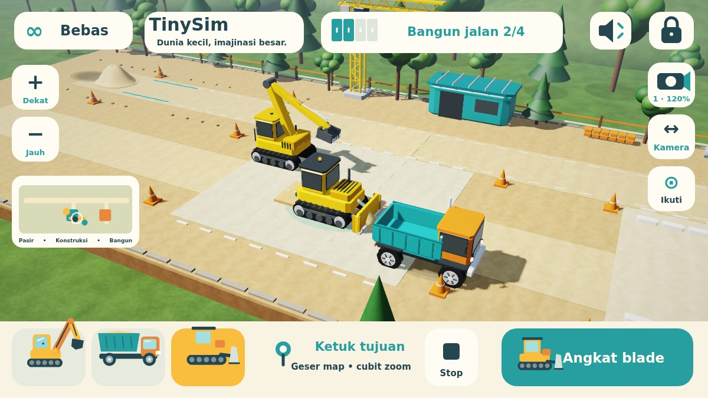

# TinySim 3D
**Dunia kecil, imajinasi besar.**

Permainan konstruksi offline untuk anak usia 2–6 tahun. Versi **0.1.0-alpha.6**, package `com.dromadi.tinysim`, Android 8.0+ / OpenGL ES 2.0. Tanpa login, iklan, pembelian dalam aplikasi, analytics, backend, pengumpulan data pribadi, atau Android permission. Save dan pengaturan hanya berada di perangkat; backup/transfer aplikasi dinonaktifkan.



Pratinjau di atas menjalankan kode renderer dan HUD asli melalui JVM/WebGL/Canvas browser. Ini bukan screenshot HP; bentuk font dapat berbeda dari Android.

## Alpha.6: excavator bergerak, gali ulang, bangun jalan

- **Ketiga kendaraan dapat berjalan** di map 62 × 22 unit dengan tiga area terhubung. Ketuk tanah atau seret badan kendaraan untuk menuju tujuan; track excavator ikut berputar.
- Ketuk tumpukan pasir dengan excavator terpilih. Mesin mendekati tumpukan yang jauh, mengarahkan lengan, lalu mengambil pasir. Pasir hasil bongkar truk bisa digali dan dimuat kembali; bekas pengambilan ditandai guratan pada permukaan.
- Lengan memakai dua ruas berpanjang tetap, dengan posisi render dan ray picking yang mengikuti posisi/rotasi excavator. **Isi truk** memanggil truk ke posisi pemuatan excavator saat ini, termasuk area yang jauh.
- **Proyek jalan** berada di halaman konstruksi: empat petak berbingkai jingga pada x=16–24, z=7–9. Tuang pasir, turunkan blade bulldozer, lalu lintasi petak untuk membentuk jalan kerikil. Pasir yang terpasang masuk hitungan inventori; jalan selesai memunculkan perayaan lembut.
- Misi bergambar bertambah menjadi isi truk → tuang → ratakan → bangun empat bagian jalan. Semua kegiatan juga tersedia dalam bermain bebas.
- Tidak ada joystick/tombol arah. Pan/pinch, minimap, Ikuti, Stop, kualitas pencahayaan/material/bayangan, privasi, dan lifecycle tetap dipertahankan.
- Save alpha.1–alpha.5 dimigrasikan. Posisi/arah excavator, pasir, bekas penggalian, dan bagian jalan tersimpan lokal. Reset juga mengembalikan kamera ke area awal.

## Cara bermain

1. Pilih kendaraan dengan menyentuh modelnya atau kartu kendaraan di bawah.
2. **Excavator:** ketuk tanah kosong atau seret badan mesin untuk berpindah. Ketuk tumpukan pasir untuk mendekat dan mengambilnya, atau seret pin/bucket ke pasir lalu ke atas bak truk. Tombol **Ambil pasir** memilih tumpukan terdekat (sumber awal jika tidak ada tumpukan lepas). Saat bucket terisi, sentuh truk atau **Isi truk**; truk dipanggil ke lokasi excavator sekarang. Pasir yang sudah dituang bisa diambil lagi.
3. **Truk / bulldozer:** ketuk tanah untuk menuju titik tersebut, atau seret model kendaraan ke tujuan. Sentuh model yang sudah dipilih sekali lagi untuk mengangkat/menurunkan bak atau blade; tombol aksi besar menyediakan fungsi yang sama. Tombol **Stop** menghentikan semua perjalanan.
4. **Jelajah:** seret ruang kosong untuk menggeser map. Dua jari menggeser dan mencubit untuk zoom. Tombol **Kamera/Putar** mengganti seret menjadi orbit; dua jari pada mode tersebut juga mengorbit. Tombol +/− menyediakan alternatif zoom. Minimap di kiri menempatkan pandangan pada area yang disentuh. **Ikuti** mengembalikan kamera ke kendaraan terpilih. Tombol preset kamera mengganti sudut dan memulihkan pandangan stasiun pemuatan.
5. **Bebas / Misi:** kartu kiri atas mengganti mode. Misi bergambar: isi 4 unit, tuang 4 unit, ratakan melalui 4 perpindahan pasir, dan bangun 4 bagian jalan. Untuk proyek jalan, bawa truk ke petak jingga (muatan jatuh di belakang truk), tuang pasir, lalu lintasi pasir dengan blade bulldozer turun. Empat unit cukup untuk keempat bagian; sisa pasir tetap bisa dimainkan. Tidak ada kalah, hukuman, batas waktu, atau kewajiban membaca.
6. Speaker mengatur suara. Tahan gembok **3 detik** untuk area orang tua: suara, reset dengan konfirmasi, dan mode. Back menutup panel lalu mengikuti perilaku Android. Perjalanan dibatalkan ketika aplikasi masuk background; posisi terakhir tersimpan.

Ada 36 unit pasir yang tetap terhitung di sumber, bucket, bak, tanah, dan jalan yang terpasang. Reset orang tua memulai dunia baru. Kendaraan dibatasi di dalam lahan kerja; dekorasi tidak memakai simulasi tabrakan rigid-body.

## Teknologi dan struktur

Kotlin + **OpenGL ES 2.0 / GLSurfaceView** menggambar dunia 3D, dengan Canvas untuk HUD. Integrasi native mempertahankan lifecycle Android dan memisahkan input, simulasi, serta rendering. Tidak ada dependency runtime pihak ketiga; seluruh model dan material dihasilkan lokal tanpa unduhan aset.

- `GameState`: perjalanan ke tujuan, putaran kendaraan, transfer pasir, misi, dan snapshot.
- `WorldMap`: batas lahan, grid 62 × 22 sel pasir, konversi posisi dan tetangga sel.
- `ArmRig`: inverse kinematics dua ruas dan batas jangkauan excavator.
- `TouchController`: state machine gestur murni Kotlin; `GameInput` mengadaptasi event/pointer Android ke pengenal tersebut.
- `scene/WorldCamera`: kamera perspektif, pan/orbit/zoom, ray picking tanah dan bidang lengan.
- `scene/SceneFrame`: snapshot dengan salinan array pasir, jalan, dan bekas penggalian milik thread GL.
- `scene/SceneRenderer3D`, `Geometry`: model berhierarki, VBO, depth/shadow pass, material, langit, partikel, dan dekorasi. GPU tanpa highp memakai shader warna mediump tanpa shadow map.
- `GameRenderer`: HUD, ikon, minimap, dan kontrol sentuh besar.
- `GameAudio`: tone sintetis Android bervolume rendah dengan pembatas frekuensi.
- `SettingsStore`: SharedPreferences lokal untuk dunia, suara, dan kamera.
- `GameView` / `MainActivity`: simulasi pada thread UI, snapshot ke GL, pause/resume, dan Back.

Pasir memakai sel deterministik yang stabil, bukan granular physics bebas. Bekas penggalian berupa tanda permukaan pada sel pasir yang diambil; tanah dasar belum memakai mesh deformasi. Jalan terdiri dari empat bagian kerikil yang tetap terpasang sampai reset. Save baru berawalan `6|`; format `5|` serta save lama 12/16 field dengan 24 sel dimigrasikan tanpa menghilangkan pasir. Rute aktif tidak dipulihkan setelah background/cold launch; posisi dan muatan tetap dipertahankan.

## Build dan pemasangan

JDK 17, Android SDK 35, Gradle wrapper 8.9 dengan checksum distribusi.

```sh
# Atur ANDROID_HOME atau sdk.dir pada local.properties.
./gradlew testDebugUnitTest lintDebug assembleDebug assembleDebugAndroidTest
adb install -r app/build/outputs/apk/debug/app-debug.apk
adb shell am start -n com.dromadi.tinysim/.MainActivity
```

Actions **Android debug** menyediakan artifact **TinySim-0.1.0-alpha.6-debug** dan **verification-reports**. Debug key lokal dan CI dapat berbeda. Pembaruan lintas key ditolak Android; uninstall menghapus save. APK lokal alpha.6 memakai key yang sama dengan APK lokal alpha.4/alpha.5 selama key pengembangan tersebut tetap tersedia.

Runner pengujian sentuh terpisah:

```sh
adb install -r app/build/outputs/apk/androidTest/debug/app-debug-androidTest.apk
adb shell am instrument -w com.dromadi.tinysim.test/com.dromadi.tinysim.SmokeInstrumentation
```

Runner bukan bagian APK permainan. Hasil sukses harus berisi `result=PASS`. Lihat [VERIFICATION.md](VERIFICATION.md) untuk membedakan pengujian yang sudah dijalankan dan yang baru dikompilasi. Pratinjau renderer/HUD tersedia di `tools/scene-preview`.

## Pengembangan berikutnya

- Menambah aktivitas crane, pemasangan pipa, dan bangunan bertahap.
- Mesh tanah yang berubah bentuk serta proyek jalan/jembatan tambahan.
- Misi antarzona dan tutorial sentuh berbasis gambar.
- Pengujian langsung bersama anak/orang tua dan virtual accessibility nodes pada kontrol Canvas.
- Dunia kebun serta kendaraan penyelamat.

Target utama adalah HP pengguna berspesifikasi tinggi; aturan pengembangan dan prioritas grafis ada di [AGENTS.md](AGENTS.md).

## Aset dan lisensi

Model 3D, mesh, material/tekstur prosedural, shader, ikon, dan launcher dibuat sendiri di repository ini; tidak ada aset gambar/model/musik yang diunduh. Font sistem dan ToneGenerator berasal dari Android. Kode dan artwork asli TinySim berlisensi MIT (`LICENSE`); Gradle wrapper Apache-2.0. Kotlin/Android SDK adalah tool build.
