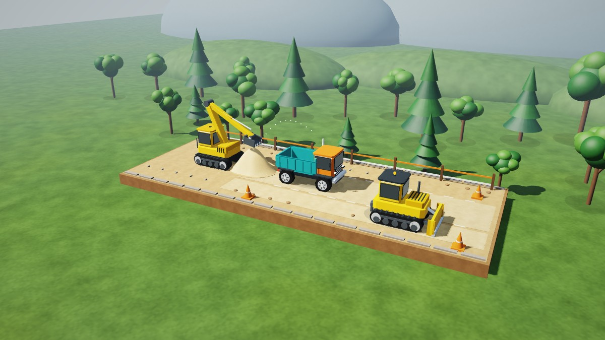

# TinySim 3D
**Dunia kecil, imajinasi besar.**

Dunia konstruksi 3D offline untuk anak usia 2–6 tahun. Versi `0.1.0-alpha.4`, package `com.dromadi.tinysim`, Android 8.0+ dengan OpenGL ES 2.0. Tanpa login, internet permission, iklan, IAP, analytics, backend, atau pengumpulan data pribadi. Save permainan, kamera, dan pilihan suara tersimpan di perangkat; backup/transfer data aplikasi dinonaktifkan.



Gambar berasal dari renderer asli melalui JVM/WebGL; bukan screenshot APK di HP.

## Yang baru di alpha.4 — interaksi dan kamera
Upgrade ini melanjutkan grafik alpha.3 dari branch `ccr-8d3a4508-l85vrd` tanpa menghapus model, material, shadow map, atau alat pratinjaunya.

- **Orbit dan zoom:** seret pada mode kamera, gunakan dua jari pada dunia untuk orbit/pinch, atau pakai tombol +/− besar. Posisi kamera tersimpan; tombol preset memulihkan sudut dan zoom awal.
- **Lengan excavator dua ruas:** inverse kinematics mempertahankan panjang boom/dipper. Jangkauan dibatasi dengan halus; gerakkan truk kembali mendekat bila terlalu jauh. Save lama di luar jangkauan dipindahkan ke batas terdekat tanpa menghilangkan pasir.
- **Pasir menyentuh jalur blade:** gundukan muatan yang diturunkan meluas sampai jalur kerja bulldozer.
- **Lampu beacon berdenyut perlahan**, menggantikan kedipan on/off.
- **Fallback GPU diperbaiki:** shader depth hanya dikompilasi setelah presisi highp diperiksa. Shader warna memiliki jalur mediump tanpa perhitungan packed depth, serta qualifier varying yang sesuai. Kegagalan shader bayangan menonaktifkan bayangan.
- **Pengujian tambahan:** batas orbit/zoom dan panjang ruas lengan diuji; APK instrumentasi terpisah disediakan untuk smoke test input di perangkat. Screenshot baru tetap berasal dari pratinjau JVM/WebGL, bukan HP.

## Grafik alpha.3 yang dipertahankan
- **Bayangan matahari asli** (shadow mapping 2048 px dengan PCF lembut) untuk kendaraan, pohon, pagar, dan pasir, ditambah ambient occlusion di titik kontak dengan tanah.
- **Pencahayaan linear + tone mapping filmic**: cahaya matahari hangat, ambient langit/tanah (hemisphere), specular Blinn-Phong per material, Fresnel, vignette halus.
- **Material berbeda**: cat kendaraan mengilap, logam/krom memantulkan langit, kaca kabin reflektif, karet, kayu, rumput, dan pasir berbutir. Detail permukaan dibuat prosedural di shader, tanpa file tekstur.
- **Langit dan atmosfer**: kubah langit bergradasi dengan matahari, perbukitan dan pegunungan berkabut (aerial perspective), awan bervolume.
- **Model lebih detail**: panel bertepi bevel, silinder hidrolik dengan batang krom, lampu depan/belakang, grill, spion, knalpot, lampu beacon, roda dengan jari-jari dan tapak yang ikut berputar, track yang bergerak saat kendaraan berjalan, ripper bulldozer.
- **Pasir lebih alami**: gundukan halus tidak beraturan menggantikan kerucut; debu muncul saat bulldozer mendorong.
- **Lingkungan**: padang rumput bervariasi, pohon berdaun rimbun dan pohon cemara dengan bentuk acak per posisi, deretan pohon latar.
- **Anti-aliasing 4x MSAA** bila didukung perangkat, dengan fallback otomatis. Bayangan otomatis nonaktif pada GPU tanpa presisi `highp` di fragment shader.

Perbandingan sebelum (alpha.2) dan sesudah: `docs/verification/graphics/before-alpha2.png` dan `docs/verification/graphics/*.png`.

## Alpha.2
- Dunia diorama 3D dengan mesh kendaraan, pasir, pepohonan, pagar, kerucut konstruksi, dan awan.
- Perspektif dan depth testing OpenGL, pencahayaan berdasarkan normal permukaan, bayangan kontak sederhana, roda truk berputar, serta butiran pasir 3D saat transfer.
- Lengan dan bucket excavator bergerak di dunia 3D. Bak dan pintu belakang dump truck berartikulasi; blade bulldozer bisa dinaikkan.
- Tiga kamera tetap melalui tombol kamera. Picking sentuhan dihitung ulang untuk kamera yang aktif dan diuji dengan round-trip proyeksi.
- Jalur truk dan bulldozer dipisahkan agar model kendaraan tidak saling menembus.
- UI besar tetap berupa overlay 2D yang tajam dan mudah disentuh.
- Save alpha.1 tetap dapat dibaca. Save baru juga menyimpan posisi bak, status tipping, arah bulldozer, dan status blade.

## Mainkan
- Landscape mengikuti dua orientasi landscape perangkat. Pilih kendaraan menggunakan tiga kartu di bawah.
- **Excavator:** seret pin/ujung lengan ke tumpukan pasir kiri untuk mengambil, lalu bawa ke atas bak truk. Bidang gerak lengan dikunci pada jalur kerja agar kontrol sederhana. Posisi sentuhan mengikuti perspektif kamera aktif. Tombol **Ambil pasir / Isi truk** membantu mengarahkan lengan tanpa perlu menyeret. Bawa truk kembali ke jangkauan excavator bila terlalu jauh.
- **Dump truck:** tahan panah kiri/kanan. Tombol bak mengangkat/menurunkan bak; pasir turun bertahap di belakang truk. Turunkan bak sebelum berjalan.
- **Bulldozer:** tahan panah untuk mendorong serta menyebarkan pasir. Tombol blade mengangkat/menurunkannya; pasir didorong ketika blade turun.
- **Kamera:** tombol ikon kamera mengganti tiga preset dan mengembalikan zoom/sudut awal. Tombol **Kamera/Putar** di bawahnya mengaktifkan seret satu jari untuk orbit; matikan untuk menyeret bucket lagi. Dua jari pada dunia mengorbit dan mencubit tanpa menggerakkan bucket. Tombol **+/−** di kiri memperbesar/memperkecil. Kamera dibatasi di depan bidang interaksi. Gunakan preset bila kendaraan keluar layar setelah diperbesar.
- **Bebas / Misi:** kartu kiri atas mengganti mode. Misi bergambar: muat 4 unit, buang 4 unit, ratakan melalui 4 perpindahan pasir. Empat bulatan menunjukkan progres, diikuti perayaan lembut.
- Ikon speaker mengatur suara. Tahan gembok **3 detik** untuk area orang tua: suara, reset dengan konfirmasi, dan mode. Lepas/geser jari membatalkan tahan. Back menutup panel, lalu mengikuti perilaku Android untuk keluar.
- Tidak ada kalah, hukuman, atau batas waktu. Tersedia 36 unit pasir; reset orang tua memulai dunia baru.

## Teknologi dan arsitektur
Kotlin + **OpenGL ES 2.0 / GLSurfaceView** untuk dunia 3D; Canvas untuk HUD. Tidak ada game engine atau dependency runtime pihak ketiga. Mesh dan shader dibuat lokal tanpa unduhan aset. Integrasi native mempertahankan lifecycle Android dan kontrol input yang terpisah dari rendering.

- `GameState`: logika deterministik, konservasi pasir, misi, dan save yang kompatibel dengan alpha.1. Pergerakan kendaraan tetap pada jalur X yang terkontrol. Pasir menggunakan 24 sel stabil, bukan simulasi granular bebas.
- `ArmRig`: inverse kinematics dua ruas dan pembatas jangkauan.
- `scene/Geometry`: generator cube, bevel cube, cylinder, cone, sphere, gundukan pasir, dan bidang tanah dengan normal halus; VBO diunggah sekali per konteks EGL. Winding diuji di `GeometryTest`.
- `scene/SceneRenderer3D`: dua pass per frame — depth pass dari matahari ke shadow map (kedalaman dipak ke RGBA8 karena depth texture opsional di ES 2.0), lalu pass warna dengan langit, material, bayangan, kabut, dan tone mapping. Model kendaraan berhierarki dan efek butiran/debu.
- `scene/MultisampleConfigChooser`: memilih konfigurasi EGL 4x MSAA dengan fallback.
- `scene/WorldCamera`: preset/orbit/zoom kamera perspektif dan ray-plane picking murni Kotlin, dipakai bersama oleh rendering dan input.
- `scene/SceneFrame`: snapshot milik thread GL dengan salinan array pasir. Thread GL tidak memodifikasi GameState.
- `GameRenderer`: overlay Canvas dan piktogram asli untuk kontrol.
- `GameInput`: satu pointer pemilik, hold-to-move, drag, isolasi gestur orbit/pinch dua jari, dan gestur orang tua.
- `GameAudio`: tone sintetis Android bervolume rendah dengan pembatas frekuensi.
- `SettingsStore`: SharedPreferences lokal.
- `GameView` / `MainActivity`: simulasi pada thread UI dan frame vsync; GL menggunakan render-when-dirty dari snapshot. Pause menghentikan loop, sentuhan, audio, serta thread GL; resume mengatur ulang frame clock. Konteks EGL dipertahankan jika memungkinkan dan resource dibuat kembali saat konteks hilang.

## Build
JDK 17 dan Android SDK 35. Gradle wrapper 8.9 disertakan dengan checksum distribusi.
```sh
# Set ANDROID_HOME ke SDK, atau tulis sdk.dir dalam local.properties.
./gradlew testDebugUnitTest lintDebug assembleDebug
```
APK: `app/build/outputs/apk/debug/app-debug.apk`.
```sh
adb install -r app/build/outputs/apk/debug/app-debug.apk
adb shell am start -n com.dromadi.tinysim/.MainActivity
```
Actions **Android debug** menjalankan tes, lint, dan build, lalu menyimpan APK dan laporan. Artifact **TinySim-0.1.0-alpha.4-debug** tersedia pada run yang sukses. APK debug lokal dan CI mungkin memakai debug key berbeda; pembaruan lintas key dapat memerlukan uninstall. Jangan uninstall bila ingin mempertahankan save lokal.

APK pengujian terpisah (bukan bagian dari APK permainan):
```sh
./gradlew assembleDebugAndroidTest
adb install -r app/build/outputs/apk/androidTest/debug/app-debug-androidTest.apk
adb shell am instrument -w com.dromadi.tinysim.test/com.dromadi.tinysim.SmokeInstrumentation
```
Runner memeriksa pinch/orbit tidak memindahkan bucket, tombol zoom, scoop → muat 4 → tuang 4 → bulldozer, konservasi 36 unit, serta tap/cancel gerbang orang tua. Sukses harus berisi `result=PASS`; instrumentation code `-1` adalah `Activity.RESULT_OK`. Runner ini belum dijalankan pada perangkat untuk alpha.4.

## Verifikasi
Lihat `VERIFICATION.md` untuk hasil aktual. Pratinjau grafik tanpa HP: `tools/scene-preview` menjalankan renderer asli di JVM lalu memutar ulang panggilan GL-nya di WebGL. Tes meliputi alur lengkap, konservasi/kapasitas pasir, batas gerak, misi, snapshot, migrasi save alpha.1, isolasi snapshot thread GL, serta proyeksi/picking ketiga kamera. Hasil emulator tidak menjadi tolok ukur FPS pada HP nyata.

## Roadmap
1. Uji bersama anak dan orang tua pada perangkat nyata; validasi ergonomi, kualitas suara dan performa Android 16.
2. Variasi misi bergambar, tutorial visual, pilihan detail grafis, serta virtual accessibility nodes untuk kontrol Canvas.
3. Area konstruksi yang lebih luas dan rute kendaraan tambahan dengan kontrol sederhana.
4. Dunia kebun dan kendaraan penyelamat menggunakan model asli.

## Aset dan lisensi
Seluruh mesh 3D, model kendaraan, dekorasi, shader, tekstur prosedural, ikon, dan launcher dibuat sendiri dalam repository ini. Tidak ada aset gambar, model, musik, atau font yang diunduh. Font sistem dan ToneGenerator disediakan Android. Kode dan artwork asli TinySim berlisensi MIT (`LICENSE`). Gradle wrapper berasal dari Gradle (Apache-2.0); Kotlin/Android SDK adalah tool build, bukan aset permainan.
