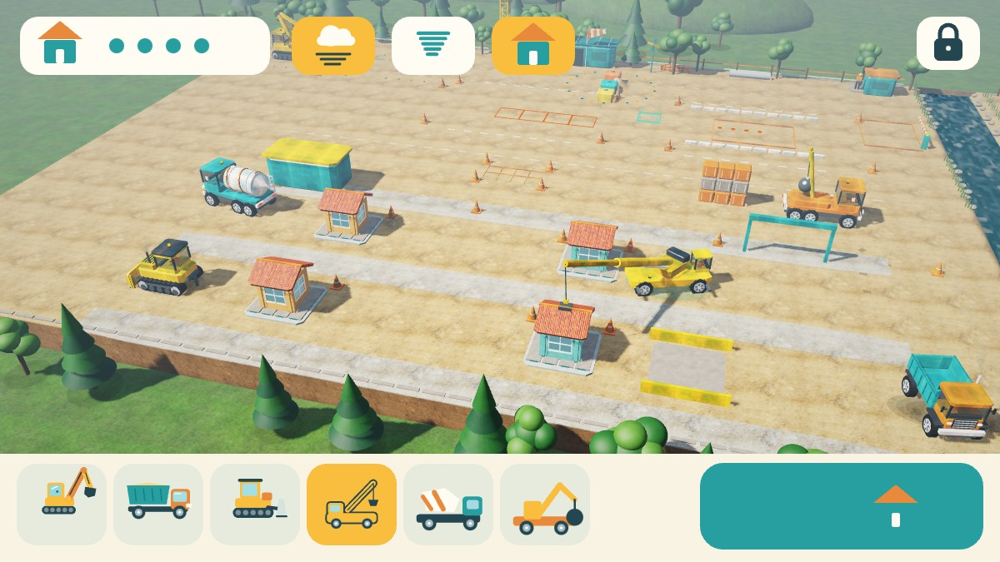

# TinySim 3D
**Dunia kecil, imajinasi besar.**

Permainan konstruksi offline untuk anak usia 2–6 tahun. Versi **0.1.0-alpha.22**, package `com.dromadi.tinysim`, Android 8.0+ / OpenGL ES 2.0. Tanpa login, iklan, pembelian dalam aplikasi, analytics, backend, pengumpulan data pribadi, atau Android permission. Save dan pengaturan hanya berada di perangkat; backup/transfer aplikasi dinonaktifkan.



Pratinjau di atas menjalankan kode renderer dan HUD asli melalui JVM/WebGL/Canvas browser. Ini bukan screenshot HP; bentuk font dapat berbeda dari Android.

## Alpha.22: satu tombol untuk memulihkan kota

- Di kawasan rumah, tombol **bulldozer + rumah** di atas berpindah dari tornado ke pekerjaan. Angin dan bagian yang melayang langsung berhenti dengan inventaris tetap utuh.
- Tombol aksi besar memilih kendaraan yang tepat lalu menjalankan satu pekerjaan: bersihkan → angkut → cor fondasi → bangun dengan crane. Ketukan berulang saat kendaraan bekerja tidak membatalkan perjalanan.
- Lima ikon pada kartu progres menunjukkan urutan tornado, bulldozer, truk, molen, rumah; tahap aktif berwarna kuning dan tahap sebelumnya diberi centang.
- Sesudah kota selesai, tombol kerja tidak memulai tornado baru. Sentuh tombol awan secara sengaja untuk bermain tornado lagi.
- Save tetap v16: tahap petunjuk diturunkan dari inventaris yang sudah disimpan, tanpa mengubah format atau mereset progres anak.
- Status verifikasi dan batas pengujian dicatat di VERIFICATION.md.

## Alpha.21: terjang, bersihkan, bangun kembali

- **Satu kawasan di peta utama.** Sentuh tombol bergambar rumah di sebelah pusaran untuk melihat kawasan baru, lalu awan atau aksi untuk menyalakan tornado. Peta tanah utama bertambah **50%: 86 × 32 menjadi 86 × 48 m**. Empat rumah latihan, jalan kerja, tempat muat dan gudang berada di selatan; keenam kendaraan lama bisa masuk melalui peta yang sama. Arena Alpha.20 tetap tersedia lewat tombol pusaran.
- **Terjang bangunan latihan.** Ketuk/seret satu jari untuk mengarahkan tornado. Dua jari tetap pan/pinch. Dinding berjendela dan atap terurai menjadi **16 bagian** yang terangkat serta berputar. Ukuran pusaran bertumbuh dalam empat tingkat berdasarkan jumlah bagian yang diterjang. Matikan awan/aksi atau pilih kendaraan: bagian turun menjadi puing di tanah. Orang, kendaraan utama dan rumah lama anak tidak diterbangkan.
- **Bulldozer membersihkan.** Pilih kartu bulldozer lalu aksi, atau sentuh puing untuk memulai langkah berikutnya. Mesin berjalan mendekat, menurunkan blade dan membawa satu bagian di depan blade sungguhan sampai ke tempat muat. Ulangi sampai bersih. Sentuh tanah kosong untuk mengemudi sendiri; perjalanan manual membatalkan pekerjaan dengan aman dan meninggalkan bagian di posisi blade.
- **Truk benar-benar mengangkut.** Aksi membawa truk ke tempat muat, memasukkan sampai **8 bagian** bertahap, berjalan ke gudang dan mengangkat bak untuk menurunkannya. Bagian di bak mengikuti gerakan bak; bagian yang sudah diturunkan menetap di gudang. Muatan pasir lama tetap dapat dikosongkan tanpa dihapus. Tempat muat yang terhalang kendaraan lain perlu dikosongkan sebelum aksi diulang.
- **Molen dan crane membangun kembali.** Molen mendekati tiap fondasi, drum berputar dan aliran beton mengisi empat petak fondasi. Stok **16 unit beton** khusus kawasan selalu sama dengan sisa stok ditambah isi fondasi. Crane memakai perjalanan, boom, tali dan kait lama untuk mengambil bagian dari gudang, lalu aksi berikutnya memasangnya pada rumah asal. Bagian yang sama dipakai kembali, tanpa menggandakan properti.
- **Bisa diterjang lagi tanpa reset dunia.** Setelah 16 bagian terpasang, bintang menandai satu siklus selesai. Sentuh awan/aksi untuk bermain lagi; fondasi beton yang sudah jadi tetap terpelihara. Pembersihan dan pembangunan kembali bersifat opsional, tanpa timer, skor kalah atau hukuman. Kontrol tetap bergambar dan tanpa joystick. Tangan penunjuk berganti antara bulldozer, truk, molen dan crane sesuai langkah berikutnya.
- **Perjalanan lebih langsung.** Rute lama dapat melewati sisa belokan ketika kendaraan penghalang sudah pindah, dengan pemeriksaan benturan sepanjang jalan pintas. Crane berjalan 3,6 m/detik untuk perjalanan antargudang dan bangunan di kawasan yang lebih luas; batas bodi serta aturan jembatan tetap berlaku.
- **Save v16.** Mempertahankan 16 identitas bagian, puing, muatan truk/crane, fondasi dan siklus selesai. Pause membatalkan perjalanan/pekerjaan, meredakan angin dan mempertahankan inventaris; tekan aksi untuk melanjutkan. Save v15/Alpha.20 dan versi lama dimigrasikan: **5.504 unit tanah awal** ditambahkan hanya pada perluasan baru, sehingga jumlah material dunia sekarang **16.572**. Tanah/pasir dan seluruh proyek lama tetap dipertahankan. Ini simulasi kinematik deterministik, bukan aerodinamika atau rigid-body bebas.
- Model bangunan, ikon dan animasi baru dibuat dengan kode asli TinySim (MIT). Audio angin, mesin, transfer bagian dan pengecoran menggunakan sistem suara lama yang benar-benar dipicu oleh aksi; tidak ada WAV, padding, duplikasi aset atau target ukuran minimum APK. Pratinjau desktop dan bukti pemeriksaan ada di [VERIFICATION.md](VERIFICATION.md); belum diuji di HP pengguna.

## Alpha.20: arena tornado yang tumbuh dan menyerap benda

- **Sentuh ikon pusaran di sebelah awan** untuk masuk ke arena. Satu jari mengarahkan tornado; dua jari tetap pan/pinch. Tombol rumah atau Back kembali ke dunia konstruksi beserta sudut kamera sebelumnya. Tidak ada joystick, kewajiban membaca, login, iklan, pembelian, leaderboard online atau koneksi jaringan.
- **Tiga peta latihan:** taman dengan bola/kerucut dan tanah bermain, kota balok dengan jalan serta bangunan mini, dan pelabuhan dengan dermaga, pelampung serta kontainer. Masing-masing memiliki **48 benda** dengan progres tersimpan terpisah: total **144 properti arena**. Arena merupakan tempat bermain tersendiri; tidak memperbesar grid tanah utama atau mengganti bangunan anak.
- **Empat tahap pertumbuhan:** menyerap benda ringan memberi tenaga untuk mengangkat peti, tong, balok dinding dan atap. Diameter corong tumbuh dari skala 0,75 ke 1,5, sedangkan jangkauan ikut membesar. Empat lingkaran dan bilah bergambar menunjukkan ukuran serta progres. Benda berat ditandai titik bobot. Ronde selesai ketika 48 identitas benda pernah terserap; bintang muncul tanpa menghentikan permainan, timer atau hukuman kalah.
- **Tiga jenis, bukan sekadar warna:** angin bergerak paling cepat (4,8 m/detik); pasir memiliki jangkauan 30% lebih lebar (3,6 m/detik); es bergerak 3,2 m/detik dan setelah 0,7 detik kontak dapat menurunkan satu tingkat kebutuhan ukuran benda. Es memberi lapisan biru serta serpih salju, pasir memiliki corong lebih pekat dan butiran emas; suara tiap jenis berbeda dan tetap naik/turun lembut.
- **Benda benar-benar terangkat:** bola, kerucut, peti, tong, pelampung, balok, atap dan segmen kontainer mengikuti orbit, lalu masuk ke inventaris pusaran. Miniatur benda terserap masih terlihat di dalamnya. Bangunan latihan terurai per bagian; bagian atas turun bila penyangganya diangkat. Tidak ada orang, kendaraan utama atau bangunan anak yang dikonsumsi. Animasi kinematik dibatasi, bukan simulasi aerodinamika/rigid-body bebas.
- **Keluarkan dan mainkan lagi:** tombol bergambar benda turun mengeluarkan inventaris yang jatuh perlahan dan menetap di tanah. Benda tidak hilang dan menyerap ulang benda yang sama tidak menggandakan tenaga/progres. Tombol panah melingkar memulai ronde baru hanya pada peta terpilih. Peta lain dan dunia konstruksi tetap tersimpan; tidak perlu reset dunia di area orang tua.
- **Solo atau duo AI offline:** tombol dua pusaran menyalakan pendamping yang bergerak sendiri dan membantu mengangkat benda. Kedua tornado berbagi pertumbuhan/progres; tidak ada musuh, PvP, pemain jaringan atau hasil kalah. Pendamping dapat dimatikan tanpa menghilangkan benda yang sedang diangkat. Tangan penunjuk mengarah ke benda yang bisa diambil ketika anak diam.
- **Save v15:** menyimpan pilihan peta/jenis/duo, posisi dan keadaan seluruh benda, inventaris terserap serta identitas yang sudah memberi tenaga. Save v14/Alpha.19 dan format lebih lama dimigrasikan. Background menghentikan tornado dan menetapkan benda yang terbang di tanah; cold restore tidak menghidupkan arena/cuaca sendiri. Dunia utama, termasuk truk yang sedang menuang, berhenti sementara selama arena dibuka. Seluruh model, ikon dan audio baru dibuat dengan kode asli (MIT), tanpa aset pengisi.

## Alpha.19: Taman Angin yang bisa disentuh

- **Sentuh awan kiri atas** untuk memasuki Taman Angin di dekat area balok. Pusaran 3D tumbuh perlahan: corong transparan dengan pita spiral, awan krem, butiran pasir dan daun berputar. Seret satu jari atau ketuk tanah untuk mengarahkannya; dua jari tetap menggeser/mencubit kamera. Tidak ada joystick atau tulisan yang harus dibaca. Sentuh awan lagi atau tombol berhenti besar untuk meredakannya; pilih kartu kendaraan untuk kembali bekerja.
- **Pasir benar-benar berpindah petak:** ketika taman pertama dibuka, enam unit diantar dari sumber pasir yang sudah ada ke petak taman, hanya sekali per dunia. Angin memindahkan satu unit pasir lepas tiap 0,12 detik dari radius 3,3 m ke petak di sekitar pusatnya. Jejak butiran menandai pengambilan. Tumpukan berubah dan bisa digali/diangkut/diratakan memakai kendaraan lama. Jumlah keseluruhan tetap **11.068 unit**. Sumber yang sudah memiliki kurang dari enam unit tidak diisi ulang secara ajaib; pasir lepas yang ada tetap dapat dimainkan.
- **Tiga balok crane ikut terangkat dan berputar** saat pusaran mendekat. Posisi tanahnya sungguh berpindah, dengan ketinggian visual yang dibatasi. Saat angin mereda, balok turun perlahan dan bisa diambil serta disusun lagi menggunakan crane. Balok yang sudah terpasang atau sedang dibawa tidak diambil angin. Kendaraan hanya bergoyang pelan; tidak diterbangkan atau dihilangkan.
- **Lingkungan merespons:** pohon di sekitar pusaran melengkung, penunjuk angin bergoyang, dan kincir bunga berputar. Desir angin dengan nada lembut disintesis langsung, naik/turun bertahap serta mengikuti mute, audio focus dan pause. Tidak ada rekaman WAV atau aset pengisi.
- **Penjaga membawa bendera kuning** ketika pusaran mendekati jembatan. Palang turun dan kendaraan baru menunggu di luar dek; kendaraan yang sudah berada di dek tetap mendapat palang terangkat. Setelah angin lewat atau berhenti, permintaan penyeberangan membuka palang kembali. Tidak ada kalah, hukuman, orang terluka, bangunan hancur, atau kewajiban membereskan taman.
- **Save v14:** tanah/pasir, posisi balok, enam kendaraan dan proyek lama tetap tersimpan; posisi terakhir pusaran dan penanda pengisian taman juga disimpan. Pause menghentikan angin dan menetapkan balok di tanah. Cold restore selalu dimulai tanpa cuaca aktif. Save v13/Alpha.18 dan format lama dimigrasikan. Perpindahan material atomik berbasis sel, orbit balok dan tinggi terangkat memakai animasi deterministik; ini bukan simulasi aerodinamika/rigid-body bebas. Fondasi rumah dan area proyek pipa dilindungi dari pemindahan pasir oleh angin.

## Alpha.18: molen, bola penghancur dan penjaga jembatan

- **Dua kendaraan baru yang bisa dikendarai:** truk molen toska-putih dan truk bola penghancur jingga. Enam kartu kendaraan tetap bergambar tanpa joystick. Ketuk tanah atau seret badan untuk berjalan; sistem rute, batas bodi, sungai dan antrean jembatan berlaku untuk keenamnya. Roda, sopir, mesin, asap, debu dan bekas ban mengikuti gerakan.
- **Molen:** pilih kartunya, sentuh kartu progres untuk melihat bengkel beton, lalu tekan aksi atau sentuh petak beton. Truk mendekat ke posisi tuang, mengaduk selama dua detik dengan drum berputar dan garis spiral jingga, kemudian menyalurkan **8 unit beton** lewat corong. Petak abu-abu muncul bertahap. Posisi kosong diperlukan; bila terhalang kendaraan lain, pindahkan penghalang lalu tekan lagi.
- **Bola penghancur:** pilih kartunya dan sentuh bangunan latihan atau tombol aksi. Truk mendekat dan mengayunkan bola baja dengan kabel. **Tiga ayunan** meruntuhkan tiga tingkat bangunan menjadi **sembilan puing** yang jatuh lalu menetap. Bunyinya berupa benturan rendah dengan attack lembut. Ayunan dibatasi lewat animasi deterministik, bukan simulasi rigid-body bebas.
- **Peta 45% lebih luas:** 86 × 22 menjadi **86 × 32 m**, dengan jalur dan bengkel baru di selatan, petak pengecoran, bangunan latihan, serta area piknik tambahan di timur sungai. Molen dan penghancur bisa langsung dimainkan tanpa harus menyelesaikan jembatan lebih dahulu.
- **Penjaga jembatan:** pondok toska, petugas berhelm yang melambai dan dua palang bergaris. Sentuh petugas/pondok untuk menyapa dan mengangkat palang jika jembatan sudah jadi. Palang juga terbuka otomatis saat kendaraan hendak menyeberang, tetap terangkat selama ada kendaraan di jembatan, dan turun perlahan setelah jalur kosong. Tidak ada hukuman atau kewajiban membaca.
- **Save v13:** menyimpan posisi dua truk, sisa beton, petak yang dicor, tingkat kerusakan dan sudut drum. Save Alpha.17/v12 serta versi lama dimigrasikan ke peta lebih besar; tanah, pipa, balok dan muatan lama dipertahankan. Pause membatalkan gerak/pekerjaan dan mempertahankan progres. Tekan aksi lagi untuk meneruskan.
- Beton (8 unit) dan balok latihan (9 buah) adalah inventaris properti terpisah, seperti balok crane, sehingga tidak menciptakan tanah/pasir. Kegiatan baru dapat dimainkan lagi setelah **reset dunia di area orang tua**. Tidak ada WAV, padding atau aset pengisi; seluruh model, ikon dan suara tambahan dibuat dengan kode asli TinySim (MIT).

## Alpha.17: gali, pasang pipa, lalu timbun

- Pilih excavator atau bulldozer, lalu sentuh kartu pipa kiri atas. Kamera memperlihatkan proyek sepanjang **6 × 2 m** di area barat. Sentuh enam tanda bucket besar: excavator mendekat, menurunkan lengan, menggali tanah sebenarnya, lalu mengayun dan meletakkan hasilnya di timbunan samping. Parit turun **0,44 m**; tanah yang dipindahkan **24 unit**, tidak dihapus.
- Setelah galian siap, tiga tanda pipa muncul. Sentuh untuk memilih crane dan mengangkat pipa jingga dari rak; sentuh lagi untuk menurunkannya ke parit. Pipa memiliki mulut gelap, gelang sambungan dan sling pengangkat. Boom, tali dan muatan memakai mekanisme crane yang sudah ada.
- Setelah tiga pipa terpasang, sentuh tanda timbun. Bulldozer mendekati timbunan dan menurunkan blade; tanah timbunan dikembalikan sedikit demi sedikit ke parit. Dua tutup inspeksi dan bendera toska menandai proyek selesai. Ini simulasi sel deterministik: penimbunan dibantu otomatis dari timbunan samping, bukan simulasi butiran tanah bebas.
- Tangan penunjuk dapat menuntun seluruh alur. Tidak ada teks pada kontrol anak, joystick, hukuman atau waktu habis. Kartu pipa dapat menutup aktivitas tanpa menghapus pekerjaan. Reset dunia tetap hanya di area orang tua.
- Save **v12** menyimpan pipa yang dibawa, pipa terpasang dan penimbunan. Save v10 (Alpha.15), v11 (Alpha.16), dan versi sebelumnya dibaca; tanah, muatan kendaraan dan balok tetap terpelihara. Animasi/perjalanan dibatalkan saat pause, lalu pekerjaan dilanjutkan dengan sentuhan berikutnya.
- Sumber Alpha.16 sebelumnya tidak sempat dipublikasikan dan hilang dari workspace. Penggalian terpandu di versi ini dibuat kembali di atas Alpha.15; ini bukan klaim pemulihan sumber Alpha.16 yang identik.
- Model/ikon pipa adalah geometri dan gambar kode asli TinySim (MIT); tidak ada berkas audio besar atau konten pengisi. Tekstur serta suara kendaraan yang sudah ada dipertahankan.

## Alpha.15: crane menyusun balok

- Area susun baru di sebelah barat rumah: tiga balok jingga, toska, dan kuning, dengan sudut diperkuat dan mata pengangkat baja. Sasaran berbingkai toska menunjukkan tingkat berikutnya dari menara.
- Pilih crane, lalu sentuh kartu progres bergambar balok di kiri atas untuk memulai dan melihat area tersebut. Sentuh balok untuk mengambilnya, lalu sentuh sasaran untuk memasangnya. Boom, tali, sling, dan balok ikut bergerak. Sentuhan dalam radius 1,8 m dari sasaran dibantu masuk ke posisi yang tepat.
- Tombol aksi besar dapat menyelesaikan seluruh kegiatan: ambil satu balok, tekan lagi untuk memasang, ulangi tiga kali. Di luar area balok, crane tetap dapat memindahkan pasir dan memasang jembatan.
- Balok juga boleh diturunkan di tanah dan diangkat kembali. Sentuhan ke sungai ditolak tanpa menghilangkan muatan. Balok merupakan tiga properti tersendiri; tidak mengurangi atau menambah material tanah/pasir.
- Bunyi benturan singkat yang disintesis langsung menandai pengambilan/pemasangan; pemasangan memberi bintang lembut. Tidak ada aset WAV, padding, duplikasi, atau batas ukuran minimum APK.
- Save v10 menyimpan lokasi, tingkat, dan balok yang sedang dibawa. Save v9 dan versi lama tetap dimigrasikan. Pause membatalkan perjalanan/gerak lengan, tetapi mempertahankan balok dan hasil susunan.
- Perbaikan tanah inkremental, suara aksi, tekstur, sungai/jembatan, serta tabrakan empat kendaraan dari Alpha.14 dipertahankan. Perubahan ini tidak mengklaim perbaikan tersebut sebagai pekerjaan baru.

## Alpha.14: kendaraan tidak saling tabrak

Fitur tabrakan ini dibuat ChatGPT di `main` (commit `9b9df77`) di atas alpha.7, lalu digabung dengan versi sungai, jembatan, dan crane.

- **Tidak saling menembus.** Excavator, truk, bulldozer, dan crane punya batas bodi yang tidak mengecil saat berputar: radius 2,0 / 2,4 / 2,5 / 2,2 m ditambah celah 0,08 m. Lengan excavator dan boom crane tetap bisa menjangkau bak truk.
- **Memutar menghindar.** Kendaraan memutari kendaraan lain yang parkir atau sedang lewat. Pergerakan dicek sepanjang lintasan, bukan hanya di titik tujuan, jadi tidak ada yang "tembus" walau langkahnya panjang.
- Tujuan yang sudah ditempati diganti dengan tempat aman terdekat.
- Save lama yang kendaraannya bertumpuk dipisahkan tanpa mengubah isi material.
- **Sadar sungai.** Jalan memutar tidak pernah masuk ke air, dan baru boleh melewati sungai lewat lantai jembatan yang sudah jadi.
- **Jembatan satu lajur.** Kendaraan yang akan menyeberang menunggu di 6 m sebelum ujung jembatan sampai lantainya kosong. Dua kendaraan yang berpapasan tidak lagi berhenti di tengah jembatan.
- **Kendaraan yang terhalang menunggu sebentar.** Selama mesin lain masih bergerak, ia menunggu hingga 3 detik sebelum menyerah.
- **Truk tidak lagi menuang miring.** Tangan penunjuk baru menyuruh truk menuang ke fondasi atau gudang jembatan kalau baknya benar-benar di atas sasaran. Kalau truk parkir miring di dekatnya, ia diarahkan ke titik sasaran dulu.
- Truk dipanggil excavator ke tempat muat yang kosong, terjangkau, dan berada di tepi sungai yang sama.

## Alpha.13: crane yang dikendalikan anak

- **Kartu kendaraan keempat: crane.** Crane bisa dipilih lewat kartunya atau dengan menyentuh modelnya, lalu berjalan di atas roda seperti kendaraan lain.
- **Sentuh tanah** saat crane terpilih:
  - Dalam jangkauan lengan (2,5–9 m), boom berputar ke titik itu, lengan memanjang/memendek, tali turun, dan grab menjepit 2 unit pasir.
  - Kalau sedang membawa pasir, sentuhan berikutnya menuangnya ke tanah, ke **bak truk** (sentuh truknya), ke fondasi, atau ke gudang material jembatan.
  - Titik yang terlalu jauh membuat crane berjalan mendekat dulu, lalu langsung bekerja.
  - Pasir tidak pernah jatuh ke sungai.
- **Tombol aksi crane** bergambar:
  - mengambil tumpukan pasir terdekat;
  - menurunkan muatan ke truk bila truk dalam jangkauan;
  - setelah gudang jembatan penuh, memasang tahap jembatan berikutnya. Crane berjalan sendiri ke tepi sungai, dan kamera mengikuti pemasangannya.
- Jembatan tidak lagi dipasang otomatis: **anak yang menekan crane** untuk setiap tahap. Tangan penunjuk menunjuk kartu crane dan tombolnya.
- Model crane mengikuti keadaan permainan: kaki penopang turun saat parkir, kabin berputar, boom terangkat, tali dan grab berayun, dan pasir terlihat di dalam grab. Ada sopir, asap knalpot, lampu putar, dan suara mesin serta hidrolik.
- Save v9 menyimpan posisi, arah, putaran boom, jangkauan, dan muatan crane. Save lama mendapat crane di tempat awalnya.

## Alpha.12: sungai dan proyek jembatan

- **Peta diperluas ke timur** (62 → 86 meter). Sebuah **sungai** dengan air yang mengalir memisahkan lokasi kerja dari tepi timur. Air beranimasi memakai riak, pantulan langit, kilau matahari, dan buih tipis. Tepi sungai diberi batu dan alang-alang.
- **Proyek jembatan:** truk mengantar 8 unit material ke **gudang material** di tepi barat (bingkai jingga, berubah toska saat penuh). Setelah itu **crane** mengangkat dan memasang jembatan sendiri dalam 3 tahap: pangkal dan pilar beton, balok baja, lalu lantai aspal dengan pagar dan lampu.
- Kendaraan baru bisa menyeberang setelah jembatan jadi. Rute otomatis melewati jembatan, dan kendaraan tidak pernah masuk ke air.
- **Tepi timur:** tambang pasir baru (24 unit) dengan bendera, taman piknik, bunga, dan pepohonan.
- Tangan penunjuk melanjutkan ke proyek jembatan setelah rumah selesai. Kartu progres menampilkan ikon jembatan. Minimap menampilkan sungai dan jembatan.
- Tumpukan pasir di tanah sekarang tampak sebagai pasir, tidak lagi seperti gundukan tanah biasa.
- Save lama (peta 62 kolom) otomatis diperlebar tanpa kehilangan material, dan tambang timur ditambahkan.

## Alpha.11: material foto realistis

- **9 material foto CC0 dari Poly Haven**: pasir, tanah lokasi berkerikil, rumput, aspal jalan, beton, cat kendaraan yang sedikit aus, kayu pagar, plester dinding, dan atap genteng tanah liat. Masing-masing memakai peta warna 2K, normal map 2K untuk relief, dan roughness 1K untuk kilap.
- Model tidak memakai UV, sehingga tekstur diproyeksikan secara **triplanar**. Pada kendaraan, tekstur ikut bergerak bersama bodi dan tidak bergeser.
- Warna tekstur disesuaikan ke palet game, sehingga kendaraan tetap kuning, oranye, dan toska.
- Ukuran APK debug naik menjadi sekitar **67,7 MB** karena tekstur foto sungguhan dalam format JPG asli dari Poly Haven, bukan pengisi.

## Alpha.10: kendaraan yang hidup

- **Suara mesin disintesis langsung:** tiap kendaraan punya mesin diesel yang nadanya naik saat melaju dan menyala pelan saat dipilih. Ada desis hidrolik saat lengan excavator bergerak, desir pasir setiap kali pasir berpindah, dan klakson saat kendaraan dipilih (truk "tit-tit", alat berat satu nada rendah). Bunyi "bip" saat pasir berpindah diganti desir pasir.
- **Sopir di setiap kabin** dengan helm kuning dan rompi oranye. Sopir melambai sekitar 2 detik saat kendaraannya dipilih. Kabin kini berongga dengan kaca tembus pandang.
- **Bodi hidup:** memantul pelan saat kendaraan berhenti dan bergetar halus saat mesin menyala. Asap knalpot keluar sesuai tenaga mesin, debu mengepul di belakang roda/track, dan **bekas roda/track** tertinggal di tanah lalu memudar dalam 30 detik.

## Alpha.9: kontrol ramah balita

- Layar anak dikurangi dari sekitar 11 tombol bertulisan menjadi 3 kartu kendaraan, 1 tombol aksi bergambar, kartu progres bergambar, dan gembok. Semua tulisan petunjuk dihapus dari layar anak.
- Zoom, kamera/orbit, Ikuti, minimap, Stop, dan speaker dipindah ke **Kontrol lanjutan** di area orang tua (default: tersembunyi). Gestur dua jari tetap bekerja.
- Tangan penunjuk beranimasi muncul saat anak diam 5 detik. Setelah 14 detik, game membantu satu langkah.
- Excavator menggali di tempat yang disentuh tanpa tombol Gali. Tahap rumah dirakit sendiri tanpa tombol Bangun. Tombol aksi bulldozer mendorong tumpukan terdekat.

## Alpha.8: tanah mulus & audio tanpa file besar

- **Pembaruan mesh tanah inkremental.** Sebelumnya setiap perubahan tanah/pasir membangun ulang seluruh mesh tanah (43.648 segitiga) di thread GL, sekitar 46–107 ms per perubahan pada CPU desktop. Sekarang `TerrainMesh` hanya menghitung ulang quad di sekitar sel yang berubah dan mengunggah baris tersebut dengan `glBufferSubData`: sekitar 0,05–0,14 ms per perubahan saat bulldozer mendorong pasir (diukur di JVM). Hasilnya identik dengan pembangunan ulang penuh (diuji).
- **Soundscape disintesis langsung saat bermain** (`Soundscape.kt`, AudioTrack streaming) dengan resep yang sama seperti paket WAV alpha.7: angin/burung di area pasir, bengkel dengan mesin jauh, taman dengan air. Tidak ada lagi sambungan loop lima menit; perpindahan area tetap crossfade 2 detik, fade-in/fade-out dan audio focus tetap dihormati.
- APK debug turun dari **173,7 MB** menjadi sekitar **0,9 MB**, karena 172,8 MB WAV tanpa kompresi tidak lagi dikemas.

## Alpha.7: tanah berubah bentuk & rumah yang bisa dibangun

- **Heightfield 3D sungguhan**: excavator mengambil tanah, permukaan turun menjadi lubang, muatan truk menjadi timbunan, dan bulldozer dapat mengisi kembali lubang. Mesh, normal pencahayaan, picking sentuhan, dan tinggi kendaraan menggunakan data permukaan yang sama.
- **Proyek rumah kecil**: gali minimal empat sel di fondasi berbingkai jingga/toska, antarkan delapan unit bahan dengan truk, lalu sentuh ikon rumah untuk membangun lantai/fondasi, dinding, serta atap. Kendaraan di tapak dipindahkan keluar sebelum perakitan. Jendela kaca, pintu, atap genteng, cerobong dan tanaman muncul bertahap. Empat titik berwarna memberi petunjuk penggalian tanpa wajib membaca.
- **Mode Gali** memakai ikon bucket besar. Saat aktif, ketuk tanah untuk menggali; matikan untuk ketuk tujuan perjalanan. Ketuk pasir lepas tetap langsung mengambil pasir pada kedua mode. Seret badan kendaraan, seret bucket, pan/pinch, minimap, Ikuti dan Stop tetap tersedia; tidak ada analog.
- Soundscape tiga area (angin/burung, bengkel dengan mesin jauh, taman/air) dengan crossfade, fade-out saat suara mati, dan audio focus. Sejak alpha.8 disintesis langsung, bukan WAV.
- Save alpha.1–alpha.6 dimigrasikan. Tanah, timbunan, kendaraan, jalan, bahan rumah dan tahap bangunan disimpan lokal. Kegiatan jalan alpha.6 tetap dapat dimainkan.

## Cara bermain

Layar anak hanya berisi **enam kartu kendaraan**, **satu tombol aksi besar**, kartu progres bergambar, awan Taman Angin, dan gembok orang tua. Tidak ada tulisan yang harus dibaca.

1. **Pilih kendaraan** dengan kartunya atau dengan menyentuh modelnya.
2. **Tombol aksi** menampilkan gambar langkah berikutnya:
   - excavator: ambil pasir (excavator mendatangi tumpukan), atau isi truk (truk datang sendiri);
   - truk: angkat/turunkan bak;
   - bulldozer: blade turun dan mendorong menembus tumpukan pasir terdekat. Jika tidak ada tumpukan, tombol mengangkat/menurunkan blade;
   - crane: ambil pasir terdekat, tuang ke truk, atau pasang tahap jembatan berikutnya.
3. **Sentuh tanah** untuk mengarahkan kendaraan terpilih. Excavator dengan bucket kosong langsung **menggali di tempat yang disentuh** dan berjalan ke sana bila jauh. Kendaraan dan bucket juga bisa diseret. Dua jari menggeser map dan mencubit untuk zoom.
4. **Susun balok:** pilih crane, sentuh kartu balok kiri atas, lalu gunakan sentuhan langsung pada balok/sasaran atau tombol aksi bergambar. Susun tiga balok menjadi menara.
5. **Tangan penunjuk:** setelah 5 detik tanpa sentuhan, tangan beranimasi menunjuk langkah berikutnya: kartu, tombol aksi, atau titik di tanah. Setelah 14 detik tanpa sentuhan, game melakukan satu langkah itu sendiri, lalu menunggu sentuhan berikutnya.
6. **Alur bermain:** ambil pasir, isi truk, tuang, ratakan dengan bulldozer. Setelah pengiriman pertama, tangan mengarah ke **fondasi rumah**: gali empat titik, antar delapan unit tanah ke kotak fondasi, lalu rumah **dirakit sendiri** dalam tiga tahap.
7. **Area orang tua** (tahan gembok **3 detik**): suara, sudut kamera, **Kontrol lanjutan** (tombol zoom +/−, kamera/orbit, Ikuti, minimap, Stop, dan speaker di layar), mode bebas/misi bergambar, mulai ulang dunia. Back menutup panel lalu mengikuti perilaku Android. Perjalanan dibatalkan ketika aplikasi masuk background; posisi terakhir tersimpan.

Molen dan penghancur memakai kegiatan bergambar di kartu progres masing-masing; sentuh kartu untuk memusatkan kamera, lalu aksi untuk bekerja.

Misi bergambar (diaktifkan di area orang tua): isi 4 unit, tuang 4 unit, ratakan, bangun 4 bagian jalan di petak jingga, lalu rumah. Tidak ada kalah, hukuman, atau batas waktu.

Sumber awal berisi 36 unit pasir, ditambah 24 unit di tambang timur. Tanah dasar memiliki 4 unit per sel (2.752 sel): total **11.068 unit material** selalu terhitung di tanah, sumber, bucket, bak, grab crane, timbunan, jalan, rumah, dan jembatan. Reset orang tua memulai dunia baru. Kendaraan dibatasi di dalam lahan kerja; dekorasi tidak memakai simulasi tabrakan rigid-body.

## Teknologi dan struktur

Kotlin + **OpenGL ES 2.0 / GLSurfaceView** menggambar dunia 3D, dengan Canvas untuk HUD. Integrasi native mempertahankan lifecycle Android dan memisahkan input, simulasi, serta rendering. Tidak ada dependency runtime pihak ketiga; seluruh model dan material dihasilkan lokal tanpa unduhan aset.

- `GameState`: perjalanan ke tujuan, putaran kendaraan, transfer pasir, misi, dan snapshot.
- `TornadoArena`: tiga arena, identitas/inventaris benda, pertumbuhan, jenis pusaran, pendamping AI, ronde ulang dan save.
- `WindPlay`: gestur tujuan pusaran, transfer pasir konservatif, orbit/ketinggian balok, taman sekali isi dan interaksi palang.
- `WorkFleet` / `BridgeKeeper`: molen, pengecoran, ayunan penghancur, puing dan palang/penjaga.
- `PipeSite`: aktivitas penggalian, pemasangan pipa dan penimbunan, dengan transfer tanah konservatif.
- `BlockYard`: tiga balok, posisi dan tingkat susunan, muatan crane, validasi serta save.
- `Terrain`: heightfield kontinu, batas tanah dasar, dan zona fondasi rumah.
- `WorldMap`: batas lahan, grid 86 × 32 sel pasir, konversi posisi dan tetangga sel.
- `ArmRig`: inverse kinematics dua ruas dan batas jangkauan excavator.
- `TouchController`: state machine gestur murni Kotlin; `GameInput` mengadaptasi event/pointer Android ke pengenal tersebut.
- `scene/WorldCamera`: kamera perspektif, pan/orbit/zoom, ray picking tanah dan bidang lengan.
- `scene/SceneFrame`: snapshot dengan salinan array tanah, pasir, jalan, dan bekas penggalian milik thread GL.
- `scene/TerrainMesh`: heightfield tanah yang diperbarui per wilayah dan diunggah per baris.
- `scene/SceneRenderer3D`, `Geometry`: model berhierarki, VBO, depth/shadow pass, material, langit, partikel, dan dekorasi. GPU tanpa highp memakai shader warna mediump tanpa shadow map.
- `GameRenderer`: HUD, ikon, minimap, dan kontrol sentuh besar.
- `Soundscape` / `GameAudio`: sintesis soundscape stereo 48 kHz serta suara mesin, hidrolik, pasir, dan klakson (`MachineSounds`) di thread audio, AudioTrack streaming, tone lembut, audio focus, fade/crossfade, dan pelepasan saat pause.
- `SettingsStore`: SharedPreferences lokal untuk dunia, suara, dan kamera.
- `GameView` / `MainActivity`: simulasi pada thread UI, snapshot ke GL, pause/resume, dan Back.

Material memakai sel deterministik, bukan granular physics bebas. Heightfield digambar pada grid 0,25 unit dengan normal permukaan; tanah dapat turun 0,88 unit hingga lapisan dasar. Tinggi timbunan visual dibatasi 24 unit material (3,12 unit tinggi), sementara seluruh material tambahan tetap tersimpan dan bisa diambil kembali. Kendaraan mengikuti tinggi permukaan pada titik pusat; belum ada suspensi/kemiringan sasis atau tabrakan bangunan/dekorasi.

Save baru berawalan `15|`. Format `14|`, `13|`, `12|`, `11|`, `10|`, `9|`, `8|`, `7|`, `6|`, `5|` serta format 12/16 field lama dimigrasikan. Bekas galian alpha.6 dahulu hanya penanda sehingga tidak diubah menjadi lubang saat migrasi. Rute dan animasi perakitan yang belum selesai dibatalkan saat background/cold restore; posisi, muatan dan tahap rumah terakhir tetap tersimpan. Jalan/rumah yang terpasang tetap ada sampai reset.

## Build dan pemasangan

JDK 17, Android SDK 35, Gradle wrapper 8.9 dengan checksum distribusi. Tidak ada aset audio yang perlu dibuat atau diunduh.

```sh
# Atur ANDROID_HOME atau sdk.dir pada local.properties.
./gradlew testDebugUnitTest lintDebug assembleDebug assembleDebugAndroidTest
adb install -r app/build/outputs/apk/debug/app-debug.apk
adb shell am start -n com.dromadi.tinysim/.MainActivity
```

Actions **Android debug** menyediakan artifact **TinySim-0.1.0-alpha.20-debug** dan **verification-reports**. Debug key lokal dan CI dapat berbeda. Pembaruan lintas key ditolak Android; uninstall menghapus save. APK lokal alpha.8 dari sesi ini dibuat dengan debug key lingkungan berbeda dari APK lokal alpha.4–alpha.7; untuk memperbarui tanpa kehilangan save, pakai APK dari GitHub Actions bila versi sebelumnya juga dari Actions.

Runner pengujian sentuh terpisah:

```sh
adb install -r app/build/outputs/apk/androidTest/debug/app-debug-androidTest.apk
adb shell am instrument -w com.dromadi.tinysim.test/com.dromadi.tinysim.SmokeInstrumentation
```

Runner bukan bagian APK permainan. Hasil sukses harus berisi `result=PASS`. Lihat [VERIFICATION.md](VERIFICATION.md) untuk membedakan pengujian yang sudah dijalankan dan yang baru dikompilasi. Pratinjau renderer/HUD tersedia di `tools/scene-preview`.

## Pengembangan berikutnya

- Sambungan air yang mengalir melalui jalur pipa dan bangunan tambahan yang memakai crane.
- Suspensi mengikuti kemiringan tanah, tabrakan dengan bangunan/dekorasi, dan proyek jembatan tambahan.
- Misi antarzona dan tutorial sentuh berbasis gambar.
- Pengujian langsung bersama anak/orang tua dan virtual accessibility nodes pada kontrol Canvas.
- Dunia kebun serta kendaraan penyelamat.

Target utama adalah HP pengguna berspesifikasi tinggi; aturan pengembangan dan prioritas grafis ada di [AGENTS.md](AGENTS.md).

## Aset dan lisensi

Model 3D, mesh, shader, ikon, dan launcher dibuat sendiri di repository ini. **Tekstur material** berasal dari [Poly Haven](https://polyhaven.com) dengan lisensi **CC0 1.0** (domain publik). Daftar aset, URL, dan checksum ada di `app/src/main/assets/textures/index.json` dan `tools/textures/README.md`; skrip `tools/textures/fetch_textures.py` mengunduh ulang file yang sama. Soundscape dan suara mesin disintesis oleh kode asli TinySim (MIT) saat bermain; tidak memakai sampel pihak ketiga. Font sistem, ToneGenerator dan AudioTrack berasal dari Android. Kode dan artwork asli TinySim berlisensi MIT (`LICENSE`); Gradle wrapper Apache-2.0. Kotlin/Android SDK adalah tool build.
