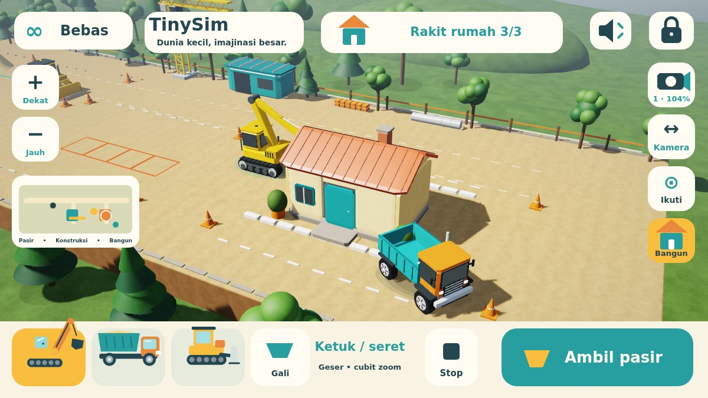

# TinySim 3D
**Dunia kecil, imajinasi besar.**

Permainan konstruksi offline untuk anak usia 2–6 tahun. Versi **0.1.0-alpha.8**, package `com.dromadi.tinysim`, Android 8.0+ / OpenGL ES 2.0. Tanpa login, iklan, pembelian dalam aplikasi, analytics, backend, pengumpulan data pribadi, atau Android permission. Save dan pengaturan hanya berada di perangkat; backup/transfer aplikasi dinonaktifkan.



Pratinjau di atas menjalankan kode renderer dan HUD asli melalui JVM/WebGL/Canvas browser. Ini bukan screenshot HP; bentuk font dapat berbeda dari Android.

## Alpha.8: tanah mulus & audio tanpa file besar

- **Tanah tidak lagi tersendat saat berubah.** Sebelumnya setiap perubahan tanah/pasir membangun ulang seluruh mesh tanah (43.648 segitiga) di thread GL, sekitar 46–107 ms per perubahan pada CPU desktop. Sekarang `TerrainMesh` hanya menghitung ulang quad di sekitar sel yang berubah dan mengunggah baris tersebut dengan `glBufferSubData`: sekitar 0,05–0,14 ms per perubahan saat bulldozer mendorong pasir (diukur di JVM). Hasilnya identik dengan pembangunan ulang penuh (diuji).
- **Soundscape disintesis langsung saat bermain** (`Soundscape.kt`, AudioTrack streaming) dengan resep yang sama seperti paket WAV alpha.7: angin/burung di area pasir, bengkel dengan mesin jauh, taman dengan air. Tidak ada lagi sambungan loop lima menit; perpindahan area tetap crossfade 2 detik, fade-in/fade-out dan audio focus tetap dihormati.
- APK debug turun dari **173,7 MB** menjadi sekitar **0,9 MB**, karena 172,8 MB WAV tanpa kompresi tidak lagi dikemas.

## Alpha.7: tanah berubah bentuk & rumah yang bisa dibangun

- **Heightfield 3D sungguhan**: excavator mengambil tanah, permukaan turun menjadi lubang, muatan truk menjadi timbunan, dan bulldozer dapat mengisi kembali lubang. Mesh, normal pencahayaan, picking sentuhan, dan tinggi kendaraan menggunakan data permukaan yang sama.
- **Proyek rumah kecil**: gali minimal empat sel di fondasi berbingkai jingga/toska, antarkan delapan unit bahan dengan truk, lalu sentuh ikon rumah untuk membangun lantai/fondasi, dinding, serta atap. Kendaraan di tapak dipindahkan keluar sebelum perakitan. Jendela kaca, pintu, atap genteng, cerobong dan tanaman muncul bertahap. Empat titik berwarna memberi petunjuk penggalian tanpa wajib membaca.
- **Mode Gali** memakai ikon bucket besar. Saat aktif, ketuk tanah untuk menggali; matikan untuk ketuk tujuan perjalanan. Ketuk pasir lepas tetap langsung mengambil pasir pada kedua mode. Seret badan kendaraan, seret bucket, pan/pinch, minimap, Ikuti dan Stop tetap tersedia; tidak ada analog.
- Soundscape tiga area (angin/burung, bengkel dengan mesin jauh, taman/air) dengan crossfade, fade-out saat suara mati, dan audio focus. Sejak alpha.8 disintesis langsung, bukan WAV.
- Save alpha.1–alpha.6 dimigrasikan. Tanah, timbunan, kendaraan, jalan, bahan rumah dan tahap bangunan disimpan lokal. Kegiatan jalan alpha.6 tetap dapat dimainkan.

## Cara bermain

1. Pilih kendaraan dengan menyentuh modelnya atau kartu kendaraan di bawah.
2. **Excavator:** seret badan mesin untuk berpindah. Dengan **Gali** tidak aktif, ketuk tanah untuk berjalan; dengan **Gali** aktif, ketuk tanah untuk mendekat dan menggali. Tumpukan pasir lepas dapat langsung disentuh pada kedua mode. Seret bucket juga tetap bekerja. Saat bucket terisi, sentuh truk atau **Isi truk**; truk dipanggil ke lokasi excavator sekarang.
3. **Truk / bulldozer:** ketuk tanah untuk menuju titik tersebut, atau seret model kendaraan ke tujuan. Sentuh model yang sudah dipilih sekali lagi untuk mengangkat/menurunkan bak atau blade; tombol aksi besar menyediakan fungsi yang sama. Tombol **Stop** menghentikan semua perjalanan.
4. **Jelajah:** seret ruang kosong untuk menggeser map. Dua jari menggeser dan mencubit untuk zoom. Tombol **Kamera/Putar** mengganti seret menjadi orbit; dua jari pada mode tersebut juga mengorbit. Tombol +/− menyediakan alternatif zoom. Minimap di kiri menempatkan pandangan pada area yang disentuh. **Ikuti** mengembalikan kamera ke kendaraan terpilih. Tombol preset kamera mengganti sudut dan memulihkan pandangan stasiun pemuatan.
5. **Bebas / Misi:** kartu kiri atas mengganti mode. Misi bergambar: isi 4 unit, tuang 4 unit, ratakan, bangun 4 bagian jalan, lalu rumah. Untuk proyek jalan, bawa truk ke petak jingga (muatan jatuh di belakang truk), tuang pasir, lalu lintasi pasir dengan blade bulldozer turun. Empat unit cukup untuk keempat bagian; sisa pasir tetap bisa dimainkan. Tidak ada kalah, hukuman, batas waktu, atau kewajiban membaca.
6. **Rumah:** gunakan minimap ke area bangunan di kanan. Aktifkan Gali dan gali empat sel di kotak fondasi. Muat delapan unit ke truk, tuang di dalam kotak, lalu sentuh ikon **Bangun** tiga kali untuk tiga tahap. Ikon juga memusatkan kamera ke proyek.
7. Speaker mengatur suara. Tahan gembok **3 detik** untuk area orang tua: suara, reset dengan konfirmasi, dan mode. Back menutup panel lalu mengikuti perilaku Android. Perjalanan dibatalkan ketika aplikasi masuk background; posisi terakhir tersimpan.

Sumber awal berisi 36 unit pasir. Tanah dasar memiliki 4 unit per sel (1.364 sel): total **5.492 unit material** selalu terhitung di tanah, sumber, bucket, bak, timbunan, jalan, dan rumah. Reset orang tua memulai dunia baru. Kendaraan dibatasi di dalam lahan kerja; dekorasi tidak memakai simulasi tabrakan rigid-body.

## Teknologi dan struktur

Kotlin + **OpenGL ES 2.0 / GLSurfaceView** menggambar dunia 3D, dengan Canvas untuk HUD. Integrasi native mempertahankan lifecycle Android dan memisahkan input, simulasi, serta rendering. Tidak ada dependency runtime pihak ketiga; seluruh model dan material dihasilkan lokal tanpa unduhan aset.

- `GameState`: perjalanan ke tujuan, putaran kendaraan, transfer pasir, misi, dan snapshot.
- `Terrain`: heightfield kontinu, batas tanah dasar, dan zona fondasi rumah.
- `WorldMap`: batas lahan, grid 62 × 22 sel pasir, konversi posisi dan tetangga sel.
- `ArmRig`: inverse kinematics dua ruas dan batas jangkauan excavator.
- `TouchController`: state machine gestur murni Kotlin; `GameInput` mengadaptasi event/pointer Android ke pengenal tersebut.
- `scene/WorldCamera`: kamera perspektif, pan/orbit/zoom, ray picking tanah dan bidang lengan.
- `scene/SceneFrame`: snapshot dengan salinan array tanah, pasir, jalan, dan bekas penggalian milik thread GL.
- `scene/TerrainMesh`: heightfield tanah yang diperbarui per wilayah dan diunggah per baris.
- `scene/SceneRenderer3D`, `Geometry`: model berhierarki, VBO, depth/shadow pass, material, langit, partikel, dan dekorasi. GPU tanpa highp memakai shader warna mediump tanpa shadow map.
- `GameRenderer`: HUD, ikon, minimap, dan kontrol sentuh besar.
- `Soundscape` / `GameAudio`: sintesis soundscape stereo 48 kHz di thread audio, AudioTrack streaming, tone lembut, audio focus, fade/crossfade, dan pelepasan saat pause.
- `SettingsStore`: SharedPreferences lokal untuk dunia, suara, dan kamera.
- `GameView` / `MainActivity`: simulasi pada thread UI, snapshot ke GL, pause/resume, dan Back.

Material memakai sel deterministik, bukan granular physics bebas. Heightfield digambar pada grid 0,25 unit dengan normal permukaan; tanah dapat turun 0,88 unit hingga lapisan dasar. Tinggi timbunan visual dibatasi 24 unit material (3,12 unit tinggi), sementara seluruh material tambahan tetap tersimpan dan bisa diambil kembali. Kendaraan mengikuti tinggi permukaan pada titik pusat; belum ada suspensi/kemiringan sasis atau tabrakan bangunan/dekorasi.

Save baru berawalan `7|`. Format `6|`, `5|` serta format 12/16 field lama dimigrasikan. Bekas galian alpha.6 dahulu hanya penanda sehingga tidak diubah menjadi lubang saat migrasi. Rute dan animasi perakitan yang belum selesai dibatalkan saat background/cold restore; posisi, muatan dan tahap rumah terakhir tetap tersimpan. Jalan/rumah yang terpasang tetap ada sampai reset.

## Build dan pemasangan

JDK 17, Android SDK 35, Gradle wrapper 8.9 dengan checksum distribusi. Tidak ada aset audio yang perlu dibuat atau diunduh.

```sh
# Atur ANDROID_HOME atau sdk.dir pada local.properties.
./gradlew testDebugUnitTest lintDebug assembleDebug assembleDebugAndroidTest
adb install -r app/build/outputs/apk/debug/app-debug.apk
adb shell am start -n com.dromadi.tinysim/.MainActivity
```

Actions **Android debug** menyediakan artifact **TinySim-0.1.0-alpha.8-debug** dan **verification-reports**. Debug key lokal dan CI dapat berbeda. Pembaruan lintas key ditolak Android; uninstall menghapus save. APK lokal alpha.8 dari sesi ini dibuat dengan debug key lingkungan berbeda dari APK lokal alpha.4–alpha.7; untuk memperbarui tanpa kehilangan save, pakai APK dari GitHub Actions bila versi sebelumnya juga dari Actions.

Runner pengujian sentuh terpisah:

```sh
adb install -r app/build/outputs/apk/androidTest/debug/app-debug-androidTest.apk
adb shell am instrument -w com.dromadi.tinysim.test/com.dromadi.tinysim.SmokeInstrumentation
```

Runner bukan bagian APK permainan. Hasil sukses harus berisi `result=PASS`. Lihat [VERIFICATION.md](VERIFICATION.md) untuk membedakan pengujian yang sudah dijalankan dan yang baru dikompilasi. Pratinjau renderer/HUD tersedia di `tools/scene-preview`.

## Pengembangan berikutnya

- Menambah aktivitas crane, pemasangan pipa, dan bangunan bertahap.
- Suspensi mengikuti kemiringan tanah, tabrakan bangunan, dan proyek jembatan tambahan.
- Misi antarzona dan tutorial sentuh berbasis gambar.
- Pengujian langsung bersama anak/orang tua dan virtual accessibility nodes pada kontrol Canvas.
- Dunia kebun serta kendaraan penyelamat.

Target utama adalah HP pengguna berspesifikasi tinggi; aturan pengembangan dan prioritas grafis ada di [AGENTS.md](AGENTS.md).

## Aset dan lisensi

Model 3D, mesh, material/tekstur prosedural, shader, ikon, dan launcher dibuat sendiri di repository ini; tidak ada aset gambar/model/musik yang diunduh. Soundscape disintesis oleh kode asli TinySim (MIT) saat bermain; tidak memakai sampel pihak ketiga. Font sistem, ToneGenerator dan AudioTrack berasal dari Android. Kode dan artwork asli TinySim berlisensi MIT (`LICENSE`); Gradle wrapper Apache-2.0. Kotlin/Android SDK adalah tool build.
