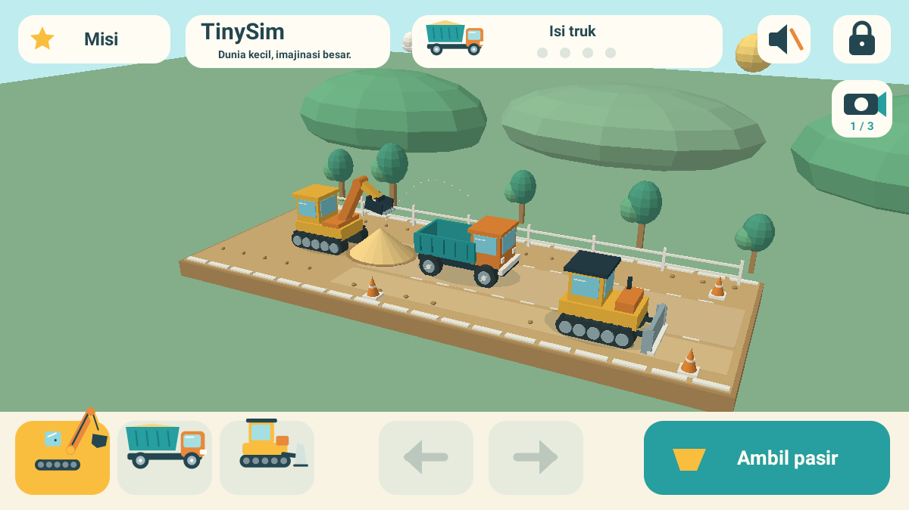

# TinySim 3D
**Dunia kecil, imajinasi besar.**

Dunia konstruksi 3D offline untuk anak usia 2–6 tahun. Versi `0.1.0-alpha.2`, package `com.dromadi.tinysim`, Android 8.0+ dengan OpenGL ES 2.0. Tanpa login, internet permission, iklan, IAP, analytics, backend, atau pengumpulan data pribadi. Save permainan, kamera, dan pilihan suara tersimpan di perangkat; backup/transfer data aplikasi dinonaktifkan.



## Yang baru di alpha.2
- Dunia diorama 3D dengan mesh kendaraan, pasir, pepohonan, pagar, kerucut konstruksi, dan awan.
- Perspektif dan depth testing OpenGL, pencahayaan berdasarkan normal permukaan, bayangan kontak sederhana, roda truk berputar, serta butiran pasir 3D saat transfer.
- Lengan dan bucket excavator bergerak di dunia 3D. Bak dan pintu belakang dump truck berartikulasi; blade bulldozer bisa dinaikkan.
- Tiga kamera tetap melalui tombol kamera. Picking sentuhan dihitung ulang untuk kamera yang aktif dan diuji dengan round-trip proyeksi.
- Jalur truk dan bulldozer dipisahkan agar model kendaraan tidak saling menembus.
- UI besar tetap berupa overlay 2D yang tajam dan mudah disentuh.
- Save alpha.1 tetap dapat dibaca. Save baru juga menyimpan posisi bak, status tipping, arah bulldozer, dan status blade.

## Mainkan
- Landscape mengikuti dua orientasi landscape perangkat. Pilih kendaraan menggunakan tiga kartu di bawah.
- **Excavator:** seret pin/ujung lengan ke tumpukan pasir kiri untuk mengambil, lalu bawa ke atas bak truk. Bidang gerak lengan dikunci pada jalur kerja agar kontrol sederhana. Posisi sentuhan mengikuti perspektif kamera aktif. Tombol **Ambil pasir / Isi truk** membantu mengarahkan lengan tanpa perlu menyeret. Bawa truk kembali ke jangkauan excavator bila terlalu jauh.
- **Dump truck:** tahan panah kiri/kanan. Tombol bak mengangkat/menurunkan bak; pasir turun bertahap di belakang truk. Turunkan bak sebelum berjalan.
- **Bulldozer:** tahan panah untuk mendorong serta menyebarkan pasir. Tombol blade mengangkat/menurunkannya; pasir didorong ketika blade turun.
- **Kamera:** tombol kamera di kanan atas area bermain mengganti tiga sudut pandang. Pilihan kamera tersimpan. Tidak ada gestur orbit bebas yang dapat mengganggu sentuhan anak.
- **Bebas / Misi:** kartu kiri atas mengganti mode. Misi bergambar: muat 4 unit, buang 4 unit, ratakan melalui 4 perpindahan pasir. Empat bulatan menunjukkan progres, diikuti perayaan lembut.
- Ikon speaker mengatur suara. Tahan gembok **3 detik** untuk area orang tua: suara, reset dengan konfirmasi, dan mode. Lepas/geser jari membatalkan tahan. Back menutup panel, lalu mengikuti perilaku Android untuk keluar.
- Tidak ada kalah, hukuman, atau batas waktu. Tersedia 36 unit pasir; reset orang tua memulai dunia baru.

## Teknologi dan arsitektur
Kotlin + **OpenGL ES 2.0 / GLSurfaceView** untuk dunia 3D; Canvas untuk HUD. Tidak ada game engine atau dependency runtime pihak ketiga. Mesh dan shader dibuat lokal, sehingga APK tetap kecil dan tidak memerlukan unduhan aset.

- `GameState`: logika deterministik, konservasi pasir, misi, dan save yang kompatibel dengan alpha.1. Pergerakan kendaraan tetap pada jalur X yang terkontrol. Pasir menggunakan 24 sel stabil, bukan simulasi granular bebas.
- `scene/Geometry`: generator cube, cylinder, cone, dan low-poly sphere beserta normal permukaan; VBO diunggah sekali per konteks EGL.
- `scene/SceneRenderer3D`: model kendaraan berhierarki, shader pencahayaan, depth testing, dekorasi, dan efek butiran. Bayangan kontak berupa geometri transparan, bukan shadow map.
- `scene/WorldCamera`: basis kamera perspektif dan ray-plane picking murni Kotlin, dipakai bersama oleh rendering dan input.
- `scene/SceneFrame`: snapshot milik thread GL dengan salinan array pasir. Thread GL tidak memodifikasi GameState.
- `GameRenderer`: overlay Canvas dan piktogram asli untuk kontrol.
- `GameInput`: satu pointer pemilik, hold-to-move, drag, pembatalan multi-jari, dan gestur orang tua.
- `GameAudio`: tone sintetis Android bervolume rendah dengan pembatas frekuensi.
- `SettingsStore`: SharedPreferences lokal.
- `GameView` / `MainActivity`: simulasi pada thread UI dan frame vsync; GL menggunakan render-when-dirty dari snapshot. Pause menghentikan loop, sentuhan, audio, serta thread GL; resume mengatur ulang frame clock. Konteks EGL dipertahankan jika memungkinkan dan resource dibuat kembali saat konteks hilang.

## Build
JDK 17 dan Android SDK 35. Gradle wrapper 8.9 disertakan dengan checksum distribusi.
```sh
# Set ANDROID_HOME ke SDK, atau tulis sdk.dir dalam local.properties.
./gradlew testDebugUnitTest lintDebug assembleDebug
```
APK: `app/build/outputs/apk/debug/app-debug.apk`.
```sh
adb install -r app/build/outputs/apk/debug/app-debug.apk
adb shell am start -n com.dromadi.tinysim/.MainActivity
```
Actions **Android debug** menjalankan tes, lint, dan build, lalu menyimpan APK dan laporan. Artifact **TinySim-0.1.0-alpha.2-debug** tersedia pada run yang sukses. APK debug lokal dan CI mungkin memakai debug key berbeda; pembaruan lintas key dapat memerlukan uninstall. Jangan uninstall bila ingin mempertahankan save lokal.

## Verifikasi
Lihat `VERIFICATION.md` untuk hasil aktual. Tes meliputi alur lengkap, konservasi/kapasitas pasir, batas gerak, misi, snapshot, migrasi save alpha.1, isolasi snapshot thread GL, serta proyeksi/picking ketiga kamera. Hasil emulator tidak menjadi tolok ukur FPS pada HP nyata.

## Roadmap
1. Uji bersama anak dan orang tua pada perangkat nyata; validasi ergonomi, kualitas suara dan performa Android 16.
2. Variasi misi bergambar, tutorial visual, pilihan detail grafis, serta virtual accessibility nodes untuk kontrol Canvas.
3. Area konstruksi yang lebih luas dan rute kendaraan tambahan dengan kontrol sederhana.
4. Dunia kebun dan kendaraan penyelamat menggunakan model asli.

## Aset dan lisensi
Seluruh mesh 3D, model kendaraan, dekorasi, shader, ikon, dan launcher dibuat sendiri dalam repository ini. Tidak ada aset gambar, model, musik, atau font yang diunduh. Font sistem dan ToneGenerator disediakan Android. Kode dan artwork asli TinySim berlisensi MIT (`LICENSE`). Gradle wrapper berasal dari Gradle (Apache-2.0); Kotlin/Android SDK adalah tool build, bukan aset permainan.
