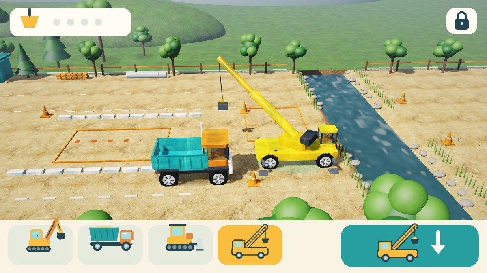

# TinySim 3D
**Dunia kecil, imajinasi besar.**

Permainan konstruksi offline untuk anak usia 2–6 tahun. Versi **0.1.0-alpha.13**, package `com.dromadi.tinysim`, Android 8.0+ / OpenGL ES 2.0. Tanpa login, iklan, pembelian dalam aplikasi, analytics, backend, pengumpulan data pribadi, atau Android permission. Save dan pengaturan hanya berada di perangkat; backup/transfer aplikasi dinonaktifkan.



Pratinjau di atas menjalankan kode renderer dan HUD asli melalui JVM/WebGL/Canvas browser. Ini bukan screenshot HP; bentuk font dapat berbeda dari Android.

## Alpha.13: crane yang dikendalikan anak

- **Kartu kendaraan keempat: crane.** Crane bisa dipilih lewat kartunya atau dengan menyentuh modelnya, lalu berjalan di atas roda seperti kendaraan lain.
- **Sentuh tanah** saat crane terpilih:
  - Dalam jangkauan lengan (2,5–9 m), boom berputar ke titik itu, lengan memanjang/memendek, tali turun, dan grab menjepit 2 unit pasir.
  - Kalau sedang membawa pasir, sentuhan berikutnya menuangnya ke tanah, ke **bak truk** (sentuh truknya), ke fondasi, atau ke gudang material jembatan.
  - Titik yang terlalu jauh membuat crane berjalan mendekat dulu, lalu langsung bekerja.
  - Pasir tidak pernah jatuh ke sungai.
- **Tombol aksi crane** bergambar:
  - mengambil tumpukan pasir terdekat;
  - menurunkan muatan ke truk bila truk dalam jangkauan;
  - setelah gudang jembatan penuh, memasang tahap jembatan berikutnya. Crane berjalan sendiri ke tepi sungai, dan kamera mengikuti pemasangannya.
- Jembatan tidak lagi dipasang otomatis: **anak yang menekan crane** untuk setiap tahap. Tangan penunjuk menunjuk kartu crane dan tombolnya.
- Model crane mengikuti keadaan permainan: kaki penopang turun saat parkir, kabin berputar, boom terangkat, tali dan grab berayun, dan pasir terlihat di dalam grab. Ada sopir, asap knalpot, lampu putar, dan suara mesin serta hidrolik.
- Save v9 menyimpan posisi, arah, putaran boom, jangkauan, dan muatan crane. Save lama mendapat crane di tempat awalnya.

## Alpha.12: sungai dan proyek jembatan

- **Peta diperluas ke timur** (62 → 86 meter). Sebuah **sungai** dengan air yang mengalir memisahkan lokasi kerja dari tepi timur. Air beranimasi memakai riak, pantulan langit, kilau matahari, dan buih tipis. Tepi sungai diberi batu dan alang-alang.
- **Proyek jembatan:** truk mengantar 8 unit material ke **gudang material** di tepi barat (bingkai jingga, berubah toska saat penuh). Setelah itu **crane** mengangkat dan memasang jembatan sendiri dalam 3 tahap: pangkal dan pilar beton, balok baja, lalu lantai aspal dengan pagar dan lampu.
- Kendaraan baru bisa menyeberang setelah jembatan jadi. Rute otomatis melewati jembatan, dan kendaraan tidak pernah masuk ke air.
- **Tepi timur:** tambang pasir baru (24 unit) dengan bendera, taman piknik, bunga, dan pepohonan.
- Tangan penunjuk melanjutkan ke proyek jembatan setelah rumah selesai. Kartu progres menampilkan ikon jembatan. Minimap menampilkan sungai dan jembatan.
- Tumpukan pasir di tanah sekarang tampak sebagai pasir, tidak lagi seperti gundukan tanah biasa.
- Save lama (peta 62 kolom) otomatis diperlebar tanpa kehilangan material, dan tambang timur ditambahkan.

## Alpha.11: material foto realistis

- **9 material foto CC0 dari Poly Haven**: pasir, tanah lokasi berkerikil, rumput, aspal jalan, beton, cat kendaraan yang sedikit aus, kayu pagar, plester dinding, dan atap genteng tanah liat. Masing-masing memakai peta warna 2K, normal map 2K untuk relief, dan roughness 1K untuk kilap.
- Model tidak memakai UV, sehingga tekstur diproyeksikan secara **triplanar**. Pada kendaraan, tekstur ikut bergerak bersama bodi dan tidak bergeser.
- Warna tekstur disesuaikan ke palet game, sehingga kendaraan tetap kuning, oranye, dan toska.
- Ukuran APK debug naik menjadi sekitar **67,7 MB** karena tekstur foto sungguhan dalam format JPG asli dari Poly Haven, bukan pengisi.

## Alpha.10: kendaraan yang hidup

- **Suara mesin disintesis langsung:** tiap kendaraan punya mesin diesel yang nadanya naik saat melaju dan menyala pelan saat dipilih. Ada desis hidrolik saat lengan excavator bergerak, desir pasir setiap kali pasir berpindah, dan klakson saat kendaraan dipilih (truk "tit-tit", alat berat satu nada rendah). Bunyi "bip" saat pasir berpindah diganti desir pasir.
- **Sopir di setiap kabin** dengan helm kuning dan rompi oranye. Sopir melambai sekitar 2 detik saat kendaraannya dipilih. Kabin kini berongga dengan kaca tembus pandang.
- **Bodi hidup:** memantul pelan saat kendaraan berhenti dan bergetar halus saat mesin menyala. Asap knalpot keluar sesuai tenaga mesin, debu mengepul di belakang roda/track, dan **bekas roda/track** tertinggal di tanah lalu memudar dalam 30 detik.

## Alpha.9: kontrol ramah balita

- Layar anak dikurangi dari sekitar 11 tombol bertulisan menjadi 3 kartu kendaraan, 1 tombol aksi bergambar, kartu progres bergambar, dan gembok. Semua tulisan petunjuk dihapus dari layar anak.
- Zoom, kamera/orbit, Ikuti, minimap, Stop, dan speaker dipindah ke **Kontrol lanjutan** di area orang tua (default: tersembunyi). Gestur dua jari tetap bekerja.
- Tangan penunjuk beranimasi muncul saat anak diam 5 detik. Setelah 14 detik, game membantu satu langkah.
- Excavator menggali di tempat yang disentuh tanpa tombol Gali. Tahap rumah dirakit sendiri tanpa tombol Bangun. Tombol aksi bulldozer mendorong tumpukan terdekat.

## Alpha.8: tanah mulus & audio tanpa file besar

- **Tanah tidak lagi tersendat saat berubah.** Sebelumnya setiap perubahan tanah/pasir membangun ulang seluruh mesh tanah (43.648 segitiga) di thread GL, sekitar 46–107 ms per perubahan pada CPU desktop. Sekarang `TerrainMesh` hanya menghitung ulang quad di sekitar sel yang berubah dan mengunggah baris tersebut dengan `glBufferSubData`: sekitar 0,05–0,14 ms per perubahan saat bulldozer mendorong pasir (diukur di JVM). Hasilnya identik dengan pembangunan ulang penuh (diuji).
- **Soundscape disintesis langsung saat bermain** (`Soundscape.kt`, AudioTrack streaming) dengan resep yang sama seperti paket WAV alpha.7: angin/burung di area pasir, bengkel dengan mesin jauh, taman dengan air. Tidak ada lagi sambungan loop lima menit; perpindahan area tetap crossfade 2 detik, fade-in/fade-out dan audio focus tetap dihormati.
- APK debug turun dari **173,7 MB** menjadi sekitar **0,9 MB**, karena 172,8 MB WAV tanpa kompresi tidak lagi dikemas.

## Alpha.7: tanah berubah bentuk & rumah yang bisa dibangun

- **Heightfield 3D sungguhan**: excavator mengambil tanah, permukaan turun menjadi lubang, muatan truk menjadi timbunan, dan bulldozer dapat mengisi kembali lubang. Mesh, normal pencahayaan, picking sentuhan, dan tinggi kendaraan menggunakan data permukaan yang sama.
- **Proyek rumah kecil**: gali minimal empat sel di fondasi berbingkai jingga/toska, antarkan delapan unit bahan dengan truk, lalu sentuh ikon rumah untuk membangun lantai/fondasi, dinding, serta atap. Kendaraan di tapak dipindahkan keluar sebelum perakitan. Jendela kaca, pintu, atap genteng, cerobong dan tanaman muncul bertahap. Empat titik berwarna memberi petunjuk penggalian tanpa wajib membaca.
- **Mode Gali** memakai ikon bucket besar. Saat aktif, ketuk tanah untuk menggali; matikan untuk ketuk tujuan perjalanan. Ketuk pasir lepas tetap langsung mengambil pasir pada kedua mode. Seret badan kendaraan, seret bucket, pan/pinch, minimap, Ikuti dan Stop tetap tersedia; tidak ada analog.
- Soundscape tiga area (angin/burung, bengkel dengan mesin jauh, taman/air) dengan crossfade, fade-out saat suara mati, dan audio focus. Sejak alpha.8 disintesis langsung, bukan WAV.
- Save alpha.1–alpha.6 dimigrasikan. Tanah, timbunan, kendaraan, jalan, bahan rumah dan tahap bangunan disimpan lokal. Kegiatan jalan alpha.6 tetap dapat dimainkan.

## Cara bermain

Layar anak hanya berisi **empat kartu kendaraan**, **satu tombol aksi besar**, kartu progres bergambar, dan gembok orang tua. Tidak ada tulisan yang harus dibaca.

1. **Pilih kendaraan** dengan kartunya atau dengan menyentuh modelnya.
2. **Tombol aksi** menampilkan gambar langkah berikutnya:
   - excavator: ambil pasir (excavator mendatangi tumpukan), atau isi truk (truk datang sendiri);
   - truk: angkat/turunkan bak;
   - bulldozer: blade turun dan mendorong menembus tumpukan pasir terdekat. Jika tidak ada tumpukan, tombol mengangkat/menurunkan blade;
   - crane: ambil pasir terdekat, tuang ke truk, atau pasang tahap jembatan berikutnya.
3. **Sentuh tanah** untuk mengarahkan kendaraan terpilih. Excavator dengan bucket kosong langsung **menggali di tempat yang disentuh** dan berjalan ke sana bila jauh. Kendaraan dan bucket juga bisa diseret. Dua jari menggeser map dan mencubit untuk zoom.
4. **Tangan penunjuk:** setelah 5 detik tanpa sentuhan, tangan beranimasi menunjuk langkah berikutnya: kartu, tombol aksi, atau titik di tanah. Setelah 14 detik tanpa sentuhan, game melakukan satu langkah itu sendiri, lalu menunggu sentuhan berikutnya.
5. **Alur bermain:** ambil pasir, isi truk, tuang, ratakan dengan bulldozer. Setelah pengiriman pertama, tangan mengarah ke **fondasi rumah**: gali empat titik, antar delapan unit tanah ke kotak fondasi, lalu rumah **dirakit sendiri** dalam tiga tahap.
6. **Area orang tua** (tahan gembok **3 detik**): suara, sudut kamera, **Kontrol lanjutan** (tombol zoom +/−, kamera/orbit, Ikuti, minimap, Stop, dan speaker di layar), mode bebas/misi bergambar, mulai ulang dunia. Back menutup panel lalu mengikuti perilaku Android. Perjalanan dibatalkan ketika aplikasi masuk background; posisi terakhir tersimpan.

Misi bergambar (diaktifkan di area orang tua): isi 4 unit, tuang 4 unit, ratakan, bangun 4 bagian jalan di petak jingga, lalu rumah. Tidak ada kalah, hukuman, atau batas waktu.

Sumber awal berisi 36 unit pasir, ditambah 24 unit di tambang timur. Tanah dasar memiliki 4 unit per sel (1.892 sel): total **7.628 unit material** selalu terhitung di tanah, sumber, bucket, bak, grab crane, timbunan, jalan, rumah, dan jembatan. Reset orang tua memulai dunia baru. Kendaraan dibatasi di dalam lahan kerja; dekorasi tidak memakai simulasi tabrakan rigid-body.

## Teknologi dan struktur

Kotlin + **OpenGL ES 2.0 / GLSurfaceView** menggambar dunia 3D, dengan Canvas untuk HUD. Integrasi native mempertahankan lifecycle Android dan memisahkan input, simulasi, serta rendering. Tidak ada dependency runtime pihak ketiga; seluruh model dan material dihasilkan lokal tanpa unduhan aset.

- `GameState`: perjalanan ke tujuan, putaran kendaraan, transfer pasir, misi, dan snapshot.
- `Terrain`: heightfield kontinu, batas tanah dasar, dan zona fondasi rumah.
- `WorldMap`: batas lahan, grid 62 × 22 sel pasir, konversi posisi dan tetangga sel.
- `ArmRig`: inverse kinematics dua ruas dan batas jangkauan excavator.
- `TouchController`: state machine gestur murni Kotlin; `GameInput` mengadaptasi event/pointer Android ke pengenal tersebut.
- `scene/WorldCamera`: kamera perspektif, pan/orbit/zoom, ray picking tanah dan bidang lengan.
- `scene/SceneFrame`: snapshot dengan salinan array tanah, pasir, jalan, dan bekas penggalian milik thread GL.
- `scene/TerrainMesh`: heightfield tanah yang diperbarui per wilayah dan diunggah per baris.
- `scene/SceneRenderer3D`, `Geometry`: model berhierarki, VBO, depth/shadow pass, material, langit, partikel, dan dekorasi. GPU tanpa highp memakai shader warna mediump tanpa shadow map.
- `GameRenderer`: HUD, ikon, minimap, dan kontrol sentuh besar.
- `Soundscape` / `GameAudio`: sintesis soundscape stereo 48 kHz serta suara mesin, hidrolik, pasir, dan klakson (`MachineSounds`) di thread audio, AudioTrack streaming, tone lembut, audio focus, fade/crossfade, dan pelepasan saat pause.
- `SettingsStore`: SharedPreferences lokal untuk dunia, suara, dan kamera.
- `GameView` / `MainActivity`: simulasi pada thread UI, snapshot ke GL, pause/resume, dan Back.

Material memakai sel deterministik, bukan granular physics bebas. Heightfield digambar pada grid 0,25 unit dengan normal permukaan; tanah dapat turun 0,88 unit hingga lapisan dasar. Tinggi timbunan visual dibatasi 24 unit material (3,12 unit tinggi), sementara seluruh material tambahan tetap tersimpan dan bisa diambil kembali. Kendaraan mengikuti tinggi permukaan pada titik pusat; belum ada suspensi/kemiringan sasis atau tabrakan bangunan/dekorasi.

Save baru berawalan `7|`. Format `6|`, `5|` serta format 12/16 field lama dimigrasikan. Bekas galian alpha.6 dahulu hanya penanda sehingga tidak diubah menjadi lubang saat migrasi. Rute dan animasi perakitan yang belum selesai dibatalkan saat background/cold restore; posisi, muatan dan tahap rumah terakhir tetap tersimpan. Jalan/rumah yang terpasang tetap ada sampai reset.

## Build dan pemasangan

JDK 17, Android SDK 35, Gradle wrapper 8.9 dengan checksum distribusi. Tidak ada aset audio yang perlu dibuat atau diunduh.

```sh
# Atur ANDROID_HOME atau sdk.dir pada local.properties.
./gradlew testDebugUnitTest lintDebug assembleDebug assembleDebugAndroidTest
adb install -r app/build/outputs/apk/debug/app-debug.apk
adb shell am start -n com.dromadi.tinysim/.MainActivity
```

Actions **Android debug** menyediakan artifact **TinySim-0.1.0-alpha.13-debug** dan **verification-reports**. Debug key lokal dan CI dapat berbeda. Pembaruan lintas key ditolak Android; uninstall menghapus save. APK lokal alpha.8 dari sesi ini dibuat dengan debug key lingkungan berbeda dari APK lokal alpha.4–alpha.7; untuk memperbarui tanpa kehilangan save, pakai APK dari GitHub Actions bila versi sebelumnya juga dari Actions.

Runner pengujian sentuh terpisah:

```sh
adb install -r app/build/outputs/apk/androidTest/debug/app-debug-androidTest.apk
adb shell am instrument -w com.dromadi.tinysim.test/com.dromadi.tinysim.SmokeInstrumentation
```

Runner bukan bagian APK permainan. Hasil sukses harus berisi `result=PASS`. Lihat [VERIFICATION.md](VERIFICATION.md) untuk membedakan pengujian yang sudah dijalankan dan yang baru dikompilasi. Pratinjau renderer/HUD tersedia di `tools/scene-preview`.

## Pengembangan berikutnya

- Pemasangan pipa dan bangunan bertahap yang memakai crane.
- Suspensi mengikuti kemiringan tanah, tabrakan bangunan, dan proyek jembatan tambahan.
- Misi antarzona dan tutorial sentuh berbasis gambar.
- Pengujian langsung bersama anak/orang tua dan virtual accessibility nodes pada kontrol Canvas.
- Dunia kebun serta kendaraan penyelamat.

Target utama adalah HP pengguna berspesifikasi tinggi; aturan pengembangan dan prioritas grafis ada di [AGENTS.md](AGENTS.md).

## Aset dan lisensi

Model 3D, mesh, shader, ikon, dan launcher dibuat sendiri di repository ini. **Tekstur material** berasal dari [Poly Haven](https://polyhaven.com) dengan lisensi **CC0 1.0** (domain publik). Daftar aset, URL, dan checksum ada di `app/src/main/assets/textures/index.json` dan `tools/textures/README.md`; skrip `tools/textures/fetch_textures.py` mengunduh ulang file yang sama. Soundscape dan suara mesin disintesis oleh kode asli TinySim (MIT) saat bermain; tidak memakai sampel pihak ketiga. Font sistem, ToneGenerator dan AudioTrack berasal dari Android. Kode dan artwork asli TinySim berlisensi MIT (`LICENSE`); Gradle wrapper Apache-2.0. Kotlin/Android SDK adalah tool build.
