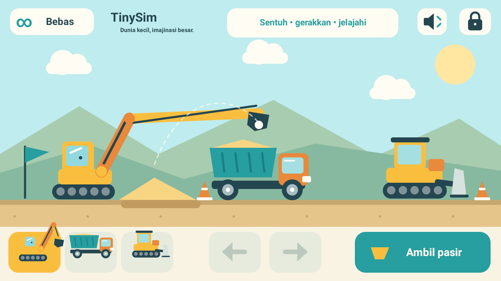

# TinySim
**Dunia kecil, imajinasi besar.**

Permainan konstruksi offline untuk anak usia 2–6 tahun. Versi `0.1.0-alpha.1`, package `com.dromadi.tinysim`, Android 8.0+. Tidak ada internet permission, login, iklan, IAP, analytics, backend, atau pengumpulan data pribadi. Dunia dan pilihan suara hanya tersimpan di perangkat, dengan backup Android dinonaktifkan.



## Mainkan
- Landscape mengikuti orientasi landscape perangkat. Pilih kendaraan menggunakan tiga kartu besar di bawah.
- **Excavator:** seret ujung lengan ke pasir di kiri untuk mengambil, lalu bawa ke atas bak truk. Lengan mengikuti sentuhan dengan lembut; mengambil/menuang otomatis di zona yang toleran. Tombol bergambar ember **Ambil pasir / Isi truk** membantu mengarahkan lengan tanpa perlu menyeret. Bawa truk kembali ke dekat excavator bila terlalu jauh.
- **Dump truck:** tahan panah kiri/kanan untuk maju/mundur. Tombol bak mengangkat/menurunkan bak; pasir turun bertahap di belakang truk. Turunkan bak sebelum berjalan.
- **Bulldozer:** tahan panah untuk mendorong dan menyebarkan pasir dengan blade di arah gerak. Tombol blade mengangkat/menurunkan blade; pasir didorong saat blade turun.
- Kartu **Bebas / Misi** mengganti mode. Misi bergambar: muat 4 unit, buang 4 unit, ratakan dengan 4 perpindahan pasir. Empat bulatan menampilkan progres. Perayaan lembut berakhir otomatis, tanpa batas waktu untuk menyelesaikan tugas.
- Ikon speaker mematikan/mengaktifkan suara. Tahan ikon gembok **3 detik** untuk area orang tua: suara, reset dengan konfirmasi, mode. Lepas/geser jari membatalkan tahan. Tombol Back menutup panel lalu mengikuti perilaku Android untuk keluar.
- Tidak ada kalah atau hukuman. Pasir tersedia 36 unit, bukan sumber tak terbatas. Bila ingin dunia baru, gunakan reset orang tua.

## Teknologi dan arsitektur
Kotlin + Android Canvas, tanpa game engine atau dependency runtime pihak ketiga. Cocok untuk dunia 2D kecil: APK ringan, gambar vektor tajam, kontrol sentuh langsung, dan tidak membutuhkan layanan jaringan.
- `GameState`: simulasi deterministik terikat, perpindahan pasir konservatif, misi, snapshot. Bukan fisika granular realistis; tumpukan berupa 24 sel stabil.
- `GameRenderer`: semua gambar vektor asli, UI, kendaraan berartikulasi, animasi, petunjuk gambar.
- `GameInput`: kepemilikan satu pointer, hold-to-move, drag, pembatalan dan gestur orang tua.
- `GameAudio`: bunyi sintetis Android dengan volume rendah dan pembatas frekuensi, menggunakan volume media perangkat.
- `SettingsStore`: SharedPreferences lokal untuk suara dan snapshot dunia.
- `GameView` / `MainActivity`: frame clock vsync, pause/resume dan navigasi. Delta waktu dibatasi 40 ms, loop serta audio dihentikan saat background. Resume tidak mengejar waktu di background. Snapshot disimpan saat pause.

## Build
JDK 17 dan Android SDK 35 diperlukan. Wrapper Gradle 8.9 disertakan.
```sh
# Arahkan ANDROID_HOME ke SDK, atau isi local.properties dengan sdk.dir
./gradlew testDebugUnitTest lintDebug assembleDebug
```
APK: `app/build/outputs/apk/debug/app-debug.apk`.
```sh
adb install -r app/build/outputs/apk/debug/app-debug.apk
adb shell am start -n com.dromadi.tinysim/.MainActivity
```
Actions `Android debug` menjalankan tes, lint dan build, lalu menyimpan APK dan laporan. Debug APK ditandatangani debug key otomatis; bukan untuk distribusi produksi. Debug key lokal dan CI dapat berbeda sehingga instalasi pembaruan lintas build mungkin membutuhkan uninstall.

## Verifikasi
Lihat `VERIFICATION.md` untuk hasil aktual sesi pembuatan. Tes unit meliputi alur lengkap, konservasi pasir, transfer tidak valid/kapasitas penuh, batas gerak, snapshot rusak, dan progres misi.

Uji manual perangkat yang perlu dilakukan: buka offline; ambil→isi→jalan→buang→ratakan; sound off/on; tahan singkat versus 3 detik; reset batal/setuju; sentuhan multi-jari; Home dan resume; Back; landscape terbalik; layar dengan cutout; volume perangkat. Alpha ini belum divalidasi bersama anak usia 2–6 tahun.

## Roadmap
1. Uji pada perangkat nyata dan bersama orang tua; sesuaikan target sentuh, audio, dan petunjuk nonteks.
2. Peningkatan efek butiran jatuh, roda berputar, pilihan kesulitan sesuai usia, dan tutorial visual tanpa teks.
3. Misi tambahan dan variasi area konstruksi; aksesibilitas TalkBack melalui virtual nodes.
4. Dunia kebun dan kendaraan penyelamat dengan aset asli.

## Aset dan lisensi
Seluruh kendaraan, lingkungan, ikon, dan launcher dibuat sebagai geometri Canvas/vector di repository ini. Tidak ada aset gambar, musik atau font yang diunduh. Font sistem Android dan ToneGenerator disediakan OS. Kode dan artwork asli TinySim tersedia dengan lisensi MIT (`LICENSE`). Gradle wrapper berasal dari Gradle (Apache-2.0); tool build Kotlin/Android digunakan saat build dan bukan aset permainan.
