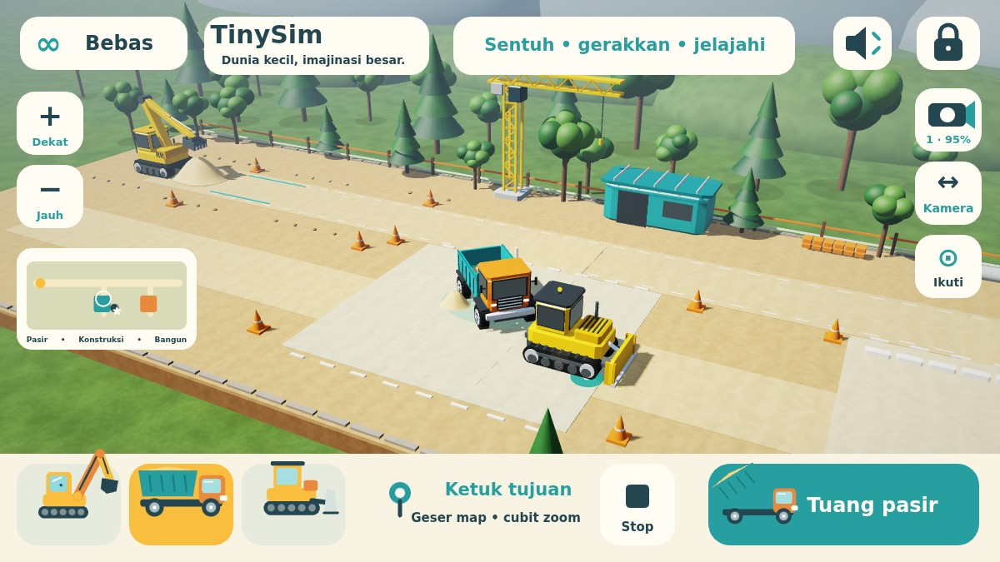

# TinySim 3D
**Dunia kecil, imajinasi besar.**

Permainan konstruksi offline untuk anak usia 2–6 tahun. Versi **0.1.0-alpha.5**, package `com.dromadi.tinysim`, Android 8.0+ / OpenGL ES 2.0. Tanpa login, iklan, pembelian dalam aplikasi, analytics, backend, pengumpulan data pribadi, atau Android permission. Save dan pengaturan hanya berada di perangkat; backup/transfer aplikasi dinonaktifkan.



Pratinjau di atas menjalankan kode renderer dan HUD asli melalui JVM/WebGL/Canvas browser. Ini bukan screenshot HP; bentuk font dapat berbeda dari Android.

## Alpha.5: map luas dan kontrol sentuh langsung

- Lahan kerja **62 × 22 unit dunia**, dibanding 22,8 × 9,1 sebelumnya: sekitar **6,6× luas area**. Seluruh lahan terhubung, dengan zona pengambilan pasir, halaman konstruksi/bengkel/crane, serta fondasi pembangunan.
- Truk dan bulldozer bergerak di dua sumbu permukaan, berbelok mengikuti tujuan, dan berhenti setelah tiba. Pasir benar-benar dapat dibawa, ditumpahkan, serta diratakan di area baru.
- **Tidak ada joystick atau tombol arah.** Ketuk tujuan atau seret kendaraan; marker dan titik jalur menunjukkan rencana perjalanan.
- Geser ruang kosong untuk menjelajah; dua jari untuk pan/pinch zoom; minimap untuk berpindah pandangan; tombol **Ikuti** mengikuti kendaraan terpilih.
- Lengan excavator tetap memakai dua ruas dengan panjang tetap. Tombol **Isi truk** dapat memanggil truk yang jauh kembali ke area pemuatan.
- Model detail, material prosedural, refleksi kaca/logam, kabut, antialiasing, dan pencahayaan alpha.3/alpha.4 dipertahankan. Shadow map diperluas hingga 4096 px pada GPU yang mendukungnya.
- Save alpha.1–alpha.4 dimigrasikan ke grid pasir dua dimensi tanpa menghilangkan pasir. Posisi kedua sumbu, arah kendaraan, lengan, bak, serta blade tersimpan.

## Cara bermain

1. Pilih kendaraan dengan menyentuh modelnya atau kartu kendaraan di bawah.
2. **Excavator:** seret pin/bucket ke pasir kiri, lalu ke atas bak truk. Ketuk tumpukan pasir atau tombol aksi untuk bantuan mengambil. Saat bucket terisi, sentuh truk atau tombol **Isi truk** untuk bantuan pemuatan. Excavator berada di stasiun pemuatan; truk yang jauh bisa dipanggil kembali melalui bantuan tersebut.
3. **Truk / bulldozer:** ketuk tanah untuk menuju titik tersebut, atau seret model kendaraan ke tujuan. Sentuh model yang sudah dipilih sekali lagi untuk mengangkat/menurunkan bak atau blade; tombol aksi besar menyediakan fungsi yang sama. Tombol **Stop** menghentikan semua perjalanan.
4. **Jelajah:** seret ruang kosong untuk menggeser map. Dua jari menggeser dan mencubit untuk zoom. Tombol **Kamera/Putar** mengganti seret menjadi orbit; dua jari pada mode tersebut juga mengorbit. Tombol +/− menyediakan alternatif zoom. Minimap di kiri menempatkan pandangan pada area yang disentuh. **Ikuti** mengembalikan kamera ke kendaraan terpilih. Tombol preset kamera mengganti sudut dan memulihkan pandangan stasiun pemuatan.
5. **Bebas / Misi:** kartu kiri atas mengganti mode. Misi bergambar: isi 4 unit, tuang 4 unit, lalu ratakan melalui 4 perpindahan pasir. Tidak ada kalah, hukuman, batas waktu, atau kewajiban membaca.
6. Speaker mengatur suara. Tahan gembok **3 detik** untuk area orang tua: suara, reset dengan konfirmasi, dan mode. Back menutup panel lalu mengikuti perilaku Android. Perjalanan dibatalkan ketika aplikasi masuk background; posisi terakhir tersimpan.

Ada 36 unit pasir yang tetap terhitung di sumber, bucket, bak, dan tanah. Reset orang tua memulai dunia baru. Kendaraan dibatasi di dalam lahan kerja; dekorasi tidak memakai simulasi tabrakan rigid-body.

## Teknologi dan struktur

Kotlin + **OpenGL ES 2.0 / GLSurfaceView** menggambar dunia 3D, dengan Canvas untuk HUD. Integrasi native mempertahankan lifecycle Android dan memisahkan input, simulasi, serta rendering. Tidak ada dependency runtime pihak ketiga; seluruh model dan material dihasilkan lokal tanpa unduhan aset.

- `GameState`: perjalanan ke tujuan, putaran kendaraan, transfer pasir, misi, dan snapshot.
- `WorldMap`: batas lahan, grid 62 × 22 sel pasir, konversi posisi dan tetangga sel.
- `ArmRig`: inverse kinematics dua ruas dan batas jangkauan excavator.
- `TouchController`: state machine gestur murni Kotlin; `GameInput` mengadaptasi event/pointer Android ke pengenal tersebut.
- `scene/WorldCamera`: kamera perspektif, pan/orbit/zoom, ray picking tanah dan bidang lengan.
- `scene/SceneFrame`: snapshot dengan salinan array pasir milik thread GL.
- `scene/SceneRenderer3D`, `Geometry`: model berhierarki, VBO, depth/shadow pass, material, langit, partikel, dan dekorasi. GPU tanpa highp memakai shader warna mediump tanpa shadow map.
- `GameRenderer`: HUD, ikon, minimap, dan kontrol sentuh besar.
- `GameAudio`: tone sintetis Android bervolume rendah dengan pembatas frekuensi.
- `SettingsStore`: SharedPreferences lokal untuk dunia, suara, dan kamera.
- `GameView` / `MainActivity`: simulasi pada thread UI, snapshot ke GL, pause/resume, dan Back.

Pasir memakai sel deterministik yang stabil, bukan granular physics bebas. Save baru berawalan `5|`; save lama 12/16 field dengan 24 sel dipetakan ke lokasi dunia yang sesuai. Rute aktif tidak dipulihkan setelah background/cold launch; posisi dan muatan tetap dipertahankan.

## Build dan pemasangan

JDK 17, Android SDK 35, Gradle wrapper 8.9 dengan checksum distribusi.

```sh
# Atur ANDROID_HOME atau sdk.dir pada local.properties.
./gradlew testDebugUnitTest lintDebug assembleDebug assembleDebugAndroidTest
adb install -r app/build/outputs/apk/debug/app-debug.apk
adb shell am start -n com.dromadi.tinysim/.MainActivity
```

Actions **Android debug** menyediakan artifact **TinySim-0.1.0-alpha.5-debug** dan **verification-reports**. Debug key lokal dan CI dapat berbeda. Pembaruan lintas key ditolak Android; uninstall menghapus save. APK lokal alpha.5 memakai key yang sama dengan APK lokal alpha.4 selama key pengembangan tersebut tetap tersedia.

Runner pengujian sentuh terpisah:

```sh
adb install -r app/build/outputs/apk/androidTest/debug/app-debug-androidTest.apk
adb shell am instrument -w com.dromadi.tinysim.test/com.dromadi.tinysim.SmokeInstrumentation
```

Runner bukan bagian APK permainan. Hasil sukses harus berisi `result=PASS`. Lihat [VERIFICATION.md](VERIFICATION.md) untuk membedakan pengujian yang sudah dijalankan dan yang baru dikompilasi. Pratinjau renderer/HUD tersedia di `tools/scene-preview`.

## Pengembangan berikutnya

- Memindahkan stasiun excavator dan menambah kendaraan/aktivitas konstruksi.
- Misi antarzona dan tutorial sentuh berbasis gambar.
- Pengujian langsung bersama anak/orang tua dan virtual accessibility nodes pada kontrol Canvas.
- Dunia kebun serta kendaraan penyelamat.

Target utama adalah HP pengguna berspesifikasi tinggi; aturan pengembangan dan prioritas grafis ada di [AGENTS.md](AGENTS.md).

## Aset dan lisensi

Model 3D, mesh, material/tekstur prosedural, shader, ikon, dan launcher dibuat sendiri di repository ini; tidak ada aset gambar/model/musik yang diunduh. Font sistem dan ToneGenerator berasal dari Android. Kode dan artwork asli TinySim berlisensi MIT (`LICENSE`); Gradle wrapper Apache-2.0. Kotlin/Android SDK adalah tool build.
